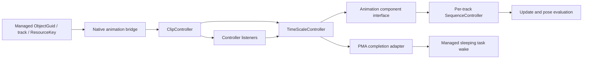

# PC 1.67 animation controllers, tracks and completion

This is a static contract of the original PC 1.67 `TS3W.exe` and matching
managed animation API. Names beginning with `AnimationController`,
`AnimationComponent`, `AnimationTrackMap` and `AnimationSequence` are analyst
names. The canonical pairs below contain actual annotated Ghidra output and
complete original instruction envelopes. No animation asset was evaluated in a
running game during this review.

The [managed entry dossier](README.md) supplies the exact registrations,
[ScriptCore IL](managed/ScriptCore-Animation.il.txt),
[ScriptCore C#](managed/ScriptCore-Animation.decompiled.cs),
[SimIFace IL](managed/Sims3-SimIFace-Animation.il.txt) and
[SimIFace C#](managed/Sims3-SimIFace-Animation.decompiled.cs).
The original `ResourceKey` field declaration is
[retained here](../../evidence/managed/types/SimIFace.ResourceKey.cs)
([original IL](../../evidence/managed/types/SimIFace.ResourceKey.il.txt)).
[Controller reference words](../../evidence/animation/controller-reference-data.tsv)
retain the original vtable targets and float constants used below.

## The chain and its two different lifetimes

The bridge temporarily retains the native object and its newly constructed
controllers. The component owns a lazy runtime; its track manager retains
per-track sequence controllers; sequence entries and wrapping controllers
retain their children. Listener registration stores a borrowed pointer. A
listener therefore has a separate removal protocol from controller/resource
reference counting. A successful managed `void` return establishes neither
asset lookup success nor clip completion.

## Object, component and input conversion

`PlayAnimation` first resolves the two DWORD words of `ObjectGuid`, retains the
object using atomic operations on object `+4`, and selects the animation
component using global `0x011DD484`. Missing object/component returns without
constructing controllers. The component type descriptor returned by
[0x0093C8F0](../../evidence/native/functions/0093C8F0_AnimationComponent_GetDescriptor.asm)
([pseudocode](../../evidence/native/functions/0093C8F0_AnimationComponent_GetDescriptor.c)) is the descriptor
named `Animation` at `0x0117C7B0`. The generic component-registration initializer
assigns the runtime mask to the global; the mask is not a fixed ID embedded in
the bridge.

The [component constructor](../../evidence/native/functions/0093D010_AnimationComponent_Construct.asm)
([pseudocode](../../evidence/native/functions/0093D010_AnimationComponent_Construct.c)) installs the animation
interface at full component `+8`, vtable `0x01044404`. That interface's attach
slot `+0x14` is `0x0093EBB0`, and stop-all slot `+0x18` is `0x0093CA90`.
Full component `+4` holds the owner object; `+0x24` initially has no runtime;
`+0x2C` starts with flags `8`; force byte `+0x38` starts zero.

For [PlayAnimation](../../evidence/native/functions/0073A870_ScriptCore_Animation_Animation_PlayAnimation.asm)
([pseudocode](../../evidence/native/functions/0073A870_ScriptCore_Animation_Animation_PlayAnimation.c)), the original x86
stack, relative to entry ESP `S`, is:

| Offset | Original input |
| --- | --- |
| `S+4`, `S+8` | ObjectGuid low/high words |
| `S+0xC` | unsigned track |
| `S+0x10` | ResourceKey TypeId |
| `S+0x14` | ResourceKey GroupId |
| `S+0x18`, `S+0x1C` | ResourceKey InstanceId low/high |
| `S+0x20` | float timeScale |
| `S+0x24` | yield BOOL slot; original instructions test its low byte |

The bridge creates a native lookup key in the order instance low/high,
type, group. It forces type `0x6B20C4F3`, ignoring the supplied TypeId.
`StartPose` follows the same conversion. The procedural-motion bridge preserves
the supplied TypeId, so these entry paths must not be generalized to the same
key-normalization rule.

## Clip resource selection and ownership

The bridge allocates `0x600` bytes for a ClipController and initializes it through
[0x00568C60](../../evidence/native/functions/00568C60_AnimationClipController_Construct.asm)
([pseudocode](../../evidence/native/functions/00568C60_AnimationClipController_Construct.c)). Its
[base constructor](../../evidence/native/functions/00565E40_AnimationController_ConstructBase.asm)
([pseudocode](../../evidence/native/functions/00565E40_AnimationController_ConstructBase.c)) starts controller
reference count `+4` at zero, initializes the listener sentinel and dispatch
depth, stores a borrowed animation-interface pointer at `+0x1C`, assigns a
controller ID at `+0x20`, and clears the completed-once byte at `+0x24`.

[LoadResource](../../evidence/native/functions/0056A170_AnimationClipController_LoadResource.asm)
([pseudocode](../../evidence/native/functions/0056A170_AnimationClipController_LoadResource.c)) calls resource-manager
vtable `+0xC` with the key, the address of a zeroed output pointer, and four zero
arguments. It returns success only in `AL`. Original instructions load the
returned resource from the output slot before binding it. Ghidra's output still
contains an output-pointer alias artifact; the plate annotation identifies the
authoritative `MOV`/`PUSH` sequence.

[BindResource](../../evidence/native/functions/0056A090_AnimationClipController_BindResource.asm)
([pseudocode](../../evidence/native/functions/0056A090_AnimationClipController_BindResource.c)) acquires the new
resource through virtual slot `+0`, stores it at controller `+0x5D0`, and releases
the previous resource through `+4`. The loader subsequently releases its
temporary lookup reference. Binding also initializes the duration, namespace
mapping and actor/rig bindings; the namespace uses lowercased FNV1 name `x`.

The [resource duration reader](../../evidence/native/functions/0057AB00_AnimationClipResource_GetDuration.asm)
([pseudocode](../../evidence/native/functions/0057AB00_AnimationClipResource_GetDuration.c)) calculates
`(frameCount - 1) * frameInterval`: frame count is a zero-extended 16-bit value
from backing data `+0xC`, header `+0x14`, and the float interval is header
`+0x10`. Zero frame count consequently produces `-1 * interval`, rather than
an unsigned wrap, in the original arithmetic. Missing backing data returns
zero. The [flags reader](../../evidence/native/functions/0057AA50_AnimationClipResource_GetFlags.asm)
([pseudocode](../../evidence/native/functions/0057AA50_AnimationClipResource_GetFlags.c)) returns backing data
`+0x1C`, or zero if absent; BindResource stores its bit 1 in controller `+0x5FB`.

The entry does not test LoadResource's boolean. A missing resource leaves the
constructed controller on the later scheduling path. This establishes the
observed failure handling; it does not establish a universal missing-animation
fallback or its diagnostic callback.

For such a controller with resource pointer still null, TotalDuration and
RemainingLifetime preserve `FLT_MAX`. Accumulated time therefore does not make
that original lifetime query negative. Stop can still issue completion. This
is a static consequence of the retained null-resource branches, without a
runtime missing-clip reproduction.

## Time, repeats and clip events

The constructor initializes repeat count to one. The following offsets are
established through both writers and readers:

| ClipController offset | Meaning in this path |
| --- | --- |
| `+0x5D0` | retained clip resource |
| `+0x5D8` | retained auxiliary/object reference copied into event payload |
| `+0x5DC` | local clip time |
| `+0x5E0` | accumulated time used for lifetime |
| `+0x5E4` | overall time field, advanced by every supplied delta |
| `+0x5E8` | duration |
| `+0x5EC` | unsigned repeat count; zero selects unbounded duration |
| `+0x5F0` | repeat iteration |
| `+0x5F4` | signed event cursor, initially `-1` |
| `+0x5F8` | Started-dispatched latch |
| `+0x5FD` | reverse event scan selector |

[SetTime](../../evidence/native/functions/00568650_AnimationClipController_SetTime.asm)
([pseudocode](../../evidence/native/functions/00568650_AnimationClipController_SetTime.c)) initializes the three
time fields. With one repeat, time at or below duration has iteration zero;
time strictly above duration has iteration one. Other counts subtract duration
repeatedly and clamp the iteration to a finite unsigned repeat count. The
[virtual setter](../../evidence/native/functions/00568720_AnimationClipController_SetTimeVirtual.asm)
([pseudocode](../../evidence/native/functions/00568720_AnimationClipController_SetTimeVirtual.c)) forwards one float
argument to this function.

[TotalDuration](../../evidence/native/functions/00568730_AnimationClipController_GetTotalDuration.asm)
([pseudocode](../../evidence/native/functions/00568730_AnimationClipController_GetTotalDuration.c)) returns unsigned
`repeatCount * duration` only for a nonzero count and non-null resource.
Otherwise it returns the original `FLT_MAX` word `0x7F7FFFFF`, rather than
infinity. The x87 unsigned conversion explicitly adds `2^32` for high-bit
counts. [RemainingLifetime](../../evidence/native/functions/00568590_AnimationClipController_GetRemainingLifetime.asm)
([pseudocode](../../evidence/native/functions/00568590_AnimationClipController_GetRemainingLifetime.c)) preserves that
sentinel, otherwise subtracts accumulated time. The
[playback-remaining query](../../evidence/native/functions/005685D0_AnimationClipController_GetPlaybackRemaining.asm)
([pseudocode](../../evidence/native/functions/005685D0_AnimationClipController_GetPlaybackRemaining.c)) instead subtracts
local clip time from clip duration.

[Clip Update](../../evidence/native/functions/00569250_AnimationClipController_Update.asm)
([pseudocode](../../evidence/native/functions/00569250_AnimationClipController_Update.c)) retains itself while
calling listeners and dispatches Started on its first update, including an
initial zero-delta update. Only a positive delta advances local and accumulated
time. It wraps at most one loop per call, under the repeat-count conditions;
the constructor's SetTime loop and the update loop are different contracts.
Remaining lifetime strictly below zero selects completion; a changed repeat
iteration selects the loop notification otherwise. Overall time advances even
for a non-positive supplied delta.

[Due-event dispatch](../../evidence/native/functions/00568DE0_AnimationClipController_DispatchDueEvents.asm)
([pseudocode](../../evidence/native/functions/00568DE0_AnimationClipController_DispatchDueEvents.c)) scans the resource
event list in order, using the persistent signed cursor to avoid duplicate
delivery. Forward events are due at `eventTime <= time`; reverse scanning tests
`eventTime >= duration - time`. Restricted flushing requires event flags bit
`4`; event bit `0x10` additionally requires bit 2 in the global animation-service
flags. The semantic names of those event flags are not recovered here.

## Time-scale wrapper and frozen poses

[TimeScale construction](../../evidence/native/functions/0056FAD0_AnimationTimeScaleController_Construct.asm)
([pseudocode](../../evidence/native/functions/0056FAD0_AnimationTimeScaleController_Construct.c)) retains its child at
`+0x2C`, stores the float scale at `+0x30`, caches `childTotalDuration / scale`
at `+0x34`, and registers its listener subobject `+0x28` on the child. There is
no zero-scale guard around the x87 division. Its
[update](../../evidence/native/functions/0056FB60_AnimationTimeScaleController_Update.asm)
([pseudocode](../../evidence/native/functions/0056FB60_AnimationTimeScaleController_Update.c)) sends
`scale * delta` to the child. Its
[lifetime query](../../evidence/native/functions/0056F980_Animation_TimeScaleLifetime.asm)
([pseudocode](../../evidence/native/functions/0056F980_Animation_TimeScaleLifetime.c)) multiplies the child's
remaining lifetime by scale. These are the actual distinct calculations;
cached total duration and queried remaining lifetime are not interchangeable.
The [forwarding playback query](../../evidence/native/functions/00565ED0_Animation_ControllerPlaybackRemaining.asm)
([pseudocode](../../evidence/native/functions/00565ED0_Animation_ControllerPlaybackRemaining.c)) tail-jumps to lifetime
and returns an x87 float; its earlier void decompilation was incorrect.

[PlayPose](../../evidence/native/functions/0073A670_ScriptCore_Animation_Animation_PlayPose.asm)
([pseudocode](../../evidence/native/functions/0073A670_ScriptCore_Animation_Animation_PlayPose.c)) builds
`Clip -> TimeScale(scale=0) -> SuppressEvents`. The
[suppress wrapper constructor](../../evidence/native/functions/0056FDE0_AnimationSuppressEventsController_Construct.asm)
([pseudocode](../../evidence/native/functions/0056FDE0_AnimationSuppressEventsController_Construct.c)) retains the child
without registering a child listener. It attaches in replacement mode with
hold-pose flag bit `8`. For a finite child lifetime, zero scale makes the
queried remaining lifetime zero, which matters before the next child tick.
This path is a retained frozen pose, with suppressed forwarded events.

## Lazy runtime, tracks, replacement and queuing

[EnsureActiveRuntime](../../evidence/native/functions/0093ECF0_AnimationComponent_EnsureActiveRuntime.asm)
([pseudocode](../../evidence/native/functions/0093ECF0_AnimationComponent_EnsureActiveRuntime.c)) checks component flag
`0x800`, uses flag `0x100` to activate once, registers with the animation service
and calls [EnsureRuntime](../../evidence/native/functions/0093DFB0_AnimationComponent_EnsureRuntime.asm)
([pseudocode](../../evidence/native/functions/0093DFB0_AnimationComponent_EnsureRuntime.c)). The latter allocates
a `0xC0` runtime if missing and initializes its transform cache from the owner's
transform component when available. The
[runtime constructor](../../evidence/native/functions/0093CFA0_AnimationComponentRuntime_Construct.asm)
([pseudocode](../../evidence/native/functions/0093CFA0_AnimationComponentRuntime_Construct.c)) creates a `0x18` track
manager at runtime `+0xB0`. Allocation failures can leave that pointer null.

[AttachTrackController](../../evidence/native/functions/0093EBB0_AnimationComponentInterface_AttachTrackController.asm)
([pseudocode](../../evidence/native/functions/0093EBB0_AnimationComponentInterface_AttachTrackController.c)) takes the component's
`+8` interface pointer, ensures activation, checks controller/runtime/manager,
and registers the track manager as a controller listener. It resolves the
unsigned track through [GetSequence](../../evidence/native/functions/00584070_AnimationTrackMap_GetSequence.asm)
([pseudocode](../../evidence/native/functions/00584070_AnimationTrackMap_GetSequence.c)) and
[FindOrCreate](../../evidence/native/functions/00583DF0_AnimationTrackMap_FindOrCreate.asm)
([pseudocode](../../evidence/native/functions/00583DF0_AnimationTrackMap_FindOrCreate.c)). Track nodes retain
their `0x70` sequence controller. Original `RET 4` and EAX flow prove a single
track input and pointer return, correcting the old decompiler's extra argument
and undefined-register return.

The [sequence constructor](../../evidence/native/functions/00567890_AnimationSequenceController_Construct.asm)
([pseudocode](../../evidence/native/functions/00567890_AnimationSequenceController_Construct.c)) owns a transition
controller, Previous entry `+0x3C`, Current entry `+0x50`, and pending list
`+0x30`. Each entry is five DWORDs: retained child, sync token, flags, float
blend-in and float blend-out. Default flags contain `0x10`. Special track
`10000` with a specific owner-component mask clears it; this exception is
limited to the original conditions.

| Attach mode | Original action |
| --- | --- |
| `1` | [ReplacePendingOrQueue](../../evidence/native/functions/00567C40_AnimationSequenceController_ReplacePendingOrQueue.asm) ([pseudocode](../../evidence/native/functions/00567C40_AnimationSequenceController_ReplacePendingOrQueue.c)): clear pending work; start immediately if unsynchronized and all slots empty, otherwise append a retained entry |
| `2` | [ReplaceCurrent](../../evidence/native/functions/00567DB0_AnimationSequenceController_ReplaceCurrent.asm) ([pseudocode](../../evidence/native/functions/00567DB0_AnimationSequenceController_ReplaceCurrent.c)): assign current, clear pending work, tick current with zero delta |
| other | Calls the append path; the bridge's ordinary play/pose paths select only modes 1 or 2 |

Mode 1 returns `AL=1` for its immediate path and `AL=0` for the queued path.
Thus zero is not necessarily a scheduling failure. The managed bridge discards
this return. `PlayAnimation(yield=true)` selects mode 1, while non-yielding play
selects mode 2. Both pass blend-in/out `-1`, no sync token, and hold-pose bit `8`;
non-yielding play additionally sets bit `1`.

[AssignCurrent](../../evidence/native/functions/00566F30_AnimationSequenceController_AssignCurrent.asm)
([pseudocode](../../evidence/native/functions/00566F30_AnimationSequenceController_AssignCurrent.c)) uses a direct
replacement for blend-in at or below zero, or an eligible empty track.
Otherwise it captures Previous and constructs a transition. Entry copying
[retains the new child before releasing the old one](../../evidence/native/functions/00566C00_AnimationSequenceEntry_CopyRetained.asm)
([pseudocode](../../evidence/native/functions/00566C00_AnimationSequenceEntry_CopyRetained.c)).

[Sequence Update](../../evidence/native/functions/00567E60_Animation_ProcessLifetimeHold.asm)
([pseudocode](../../evidence/native/functions/00567E60_Animation_ProcessLifetimeHold.c)) checks Current
lifetime before ticking. At lifetime at or below zero, it retires Current
without bit `8`; with bit `8`, it transfers the entry to Previous, constructs
a [HoldPoseController](../../evidence/native/functions/00570030_AnimationHoldPoseController_Construct.asm)
([pseudocode](../../evidence/native/functions/00570030_AnimationHoldPoseController_Construct.c)) retaining the child,
then stops that child. A
[pending promotion](../../evidence/native/functions/005673C0_AnimationSequenceController_ActivateNext.asm)
([pseudocode](../../evidence/native/functions/005673C0_AnimationSequenceController_ActivateNext.c)) transfers the first
unblocked node's retained child to Current and evaluates it with zero delta.
The guide establishes these state changes; the complete blend/synchronization
policy in Sequence Update remains partially typed.

## Listener dispatch, cancellation and completion

[Registration](../../evidence/native/functions/00576E80_AnimationController_RegisterListener.asm)
([pseudocode](../../evidence/native/functions/00576E80_AnimationController_RegisterListener.c)) allocates a 16-byte
intrusive node containing next, previous, borrowed listener and registration
token. It performs no listener AddRef. Dispatch increments depth, loads the next
node before calling the listener, and then performs deferred cleanup.

| Listener slot | Dispatch producer |
| --- | --- |
| `+0` | [Started](../../evidence/native/functions/00568A60_AnimationController_DispatchStarted.asm) ([pseudocode](../../evidence/native/functions/00568A60_AnimationController_DispatchStarted.c)) |
| `+4` | [Tick](../../evidence/native/functions/00568AB0_AnimationController_DispatchTick.asm) ([pseudocode](../../evidence/native/functions/00568AB0_AnimationController_DispatchTick.c)) |
| `+8` | [Loop](../../evidence/native/functions/00568B00_AnimationController_DispatchLoop.asm) ([pseudocode](../../evidence/native/functions/00568B00_AnimationController_DispatchLoop.c)) |
| `+0xC` | [CompletedOnce](../../evidence/native/functions/00565DF0_Animation_DispatchCompletedOnce.asm) ([pseudocode](../../evidence/native/functions/00565DF0_Animation_DispatchCompletedOnce.c)) |
| `+0x10` | [ClipEvent](../../evidence/native/functions/00568B50_AnimationController_DispatchClipEvent.asm) ([pseudocode](../../evidence/native/functions/00568B50_AnimationController_DispatchClipEvent.c)) |

CompletedOnce sets the latch before invoking any callback. It has no Started
predicate. [Unregister](../../evidence/native/functions/00566990_AnimationController_UnregisterListener.asm)
([pseudocode](../../evidence/native/functions/00566990_AnimationController_UnregisterListener.c)) removes the first
matching listener immediately at depth zero. During dispatch it clears the
node's listener/token and defers freeing until
[depth returns to zero](../../evidence/native/functions/00565D50_AnimationController_FinishListenerDispatch.asm)
([pseudocode](../../evidence/native/functions/00565D50_AnimationController_FinishListenerDispatch.c)).

[Clip Stop](../../evidence/native/functions/005694B0_Animation_ClipControllerStop.asm)
([pseudocode](../../evidence/native/functions/005694B0_Animation_ClipControllerStop.c)) conditionally flushes
restricted tail events, then always invokes
[base Stop completion](../../evidence/native/functions/005660D0_Animation_SendCompletedFromStop.asm)
([pseudocode](../../evidence/native/functions/005660D0_Animation_SendCompletedFromStop.c)). Consequently a
pending controller can complete through cancellation before Started. The
[pending clear](../../evidence/native/functions/00567330_Animation_ClearPendingSequence.asm)
([pseudocode](../../evidence/native/functions/00567330_Animation_ClearPendingSequence.c)) first detaches the
queue to a temporary list before retiring its children, permitting callbacks
to modify the live sequence safely. The
[entry retirement](../../evidence/native/functions/00566A10_Animation_RetireSequenceEntry.asm)
([pseudocode](../../evidence/native/functions/00566A10_Animation_RetireSequenceEntry.c)) retains a snapshot,
clears/releases the slot, optionally calls Stop, then releases the snapshot.
It does not itself unregister the listeners.

[StopAllAnimation](../../evidence/native/functions/0073AA40_Animation_StopAllAnimation.asm)
([pseudocode](../../evidence/native/functions/0073AA40_Animation_StopAllAnimation.c)) reaches
[component StopAll](../../evidence/native/functions/0093CA90_AnimationComponentInterface_StopAll.asm)
([pseudocode](../../evidence/native/functions/0093CA90_AnimationComponentInterface_StopAll.c)), then
[all track sequences](../../evidence/native/functions/00582BC0_AnimationTrackManager_StopAll.asm)
([pseudocode](../../evidence/native/functions/00582BC0_AnimationTrackManager_StopAll.c)).
[Sequence StopAll](../../evidence/native/functions/00567AC0_AnimationSequenceController_StopAll.asm)
([pseudocode](../../evidence/native/functions/00567AC0_AnimationSequenceController_StopAll.c)) clears transition and
pending work, snapshots/clears active slots and retires them with Stop. The
manager subsequently removes its listener from
[previous/current/pending children](../../evidence/native/functions/00566C60_AnimationSequenceController_UnregisterListenerFromChildren.asm)
([pseudocode](../../evidence/native/functions/00566C60_AnimationSequenceController_UnregisterListenerFromChildren.c)). Stop does not create
a missing runtime in the inspected component StopAll function.

## PMA adapter and the managed wake

The [script adapter constructor](../../evidence/native/functions/0073A290_AnimationScriptFunctions_Construct.asm)
([pseudocode](../../evidence/native/functions/0073A290_AnimationScriptFunctions_Construct.c)) creates a 12-byte
adapter at global `0x011D4E34`. Its listener is adapter `+4`, and its delegate
pointer is adapter `+8`. The
[delegate setter](../../evidence/native/functions/0073A250_Animation_SetPMAAnimationFinishedCallback.asm)
([pseudocode](../../evidence/native/functions/0073A250_Animation_SetPMAAnimationFinishedCallback.c)) stores that field
without a null guard or visible retain/release.

TimeScale registers a child listener whose
[completion implementation](../../evidence/native/functions/0056E8E0_AnimationWrapperListener_ForwardCompleted.asm)
([pseudocode](../../evidence/native/functions/0056E8E0_AnimationWrapperListener_ForwardCompleted.c)) retains the wrapper,
rebuilds the payload using wrapper identity and owner, and dispatches the
wrapper's CompletedOnce. The
[PMA completed listener](../../evidence/native/functions/0073B2E0_AnimationScriptListener_Completed.asm)
([pseudocode](../../evidence/native/functions/0073B2E0_AnimationScriptListener_Completed.c)) unregisters itself
first, reads ObjectGuid from the owner returned by animation-interface slot
`+0x24`, and invokes the stored managed delegate through scripting-interface
slot `+0x134` with one ObjectGuid variant. Listener ABI is `thiscall`, two stack
arguments, `RET 8`; the variant-stack expressions in the decompilation remain
artifacts identified in its annotation.

Original managed `PlayAnimation(..., yield=true)` calls the native interface
before adding the ID to its sleeping-task list. It sleeps only in a yielding
context where object ID equals the current simulator task, and removes the ID
in `finally`. The managed PMA completion callback wakes a task only if removing
its ID from that list succeeds. These ordering rules are established by the
retained IL; callback latency, reentrancy, task scheduling and actual wake
delivery were not executed here.

## Procedural motion: preserve the original SSE expression

[Procedural playback](../../evidence/native/functions/0073AC90_ScriptCore_Animation_Animation_PlayProcedurallyMotionAccumulatedAnimation.asm)
([pseudocode](../../evidence/native/functions/0073AC90_ScriptCore_Animation_Animation_PlayProcedurallyMotionAccumulatedAnimation.c)) builds
`Clip -> ProceduralMotion -> TimeScale`, always registers the PMA listener and
selects mode 1 with no flag `1` and hold-pose flag `8`.
The [motion wrapper constructor](../../evidence/native/functions/00570310_AnimationProceduralMotionController_Construct.asm)
([pseudocode](../../evidence/native/functions/00570310_AnimationProceduralMotionController_Construct.c)) stores XYZ
displacement magnitude and `(end - start) / childTotalDuration`; it retains the
child and registers a listener.

The bridge's separate time-scale expression is exactly
`1 / sqrt((endY - startY) / sampledMotionY)`. `SHUFPS 0x55` at `0x0073AE63`
and `0x0073AE69` broadcasts lane 1 of the two vectors, followed by
`DIVPS`, `SQRTPS` and reciprocal `DIVSS`. There is no XYZ dot product in that
scale expression and no zero/sign guard. Replacing it with a distance ratio
would contradict the original instructions. Degenerate inputs and their
runtime consequences remain untested.

The [motion-sample wrapper](../../evidence/native/functions/00848A80_AnimationController_SampleTotalMotion.asm)
([pseudocode](../../evidence/native/functions/00848A80_AnimationController_SampleTotalMotion.c)) forwards to
[the sampler](../../evidence/native/functions/00848810_AnimationController_SampleTotalMotionAndSpeed.asm)
([pseudocode](../../evidence/native/functions/00848810_AnimationController_SampleTotalMotionAndSpeed.c)), which saves current
time, seeks total duration, evaluates the controller and restores the saved
time before resolving the owner's rig/evaluation output. It outputs translation
and rotation and returns XYZ translation magnitude in ST0. The bridge discards
that scalar return and consumes translation lane 1. This distinction explains
why the magnitude returned by the sampler cannot silently replace the bridge's
SSE denominator.

## Destruction and remaining boundaries

[TimeScale destruction](../../evidence/native/functions/0056FC70_AnimationTimeScaleController_Destroy.asm)
([pseudocode](../../evidence/native/functions/0056FC70_AnimationTimeScaleController_Destroy.c)) unregisters its child
listener before releasing the retained child.
[Clip destruction](../../evidence/native/functions/00568BA0_AnimationClipController_Destroy.asm)
([pseudocode](../../evidence/native/functions/00568BA0_AnimationClipController_Destroy.c)) releases auxiliary
object and resource references, namespace bindings and the base listener list.
Bridge temporaries are released after attachment; the retained sequence/child
references keep scheduled work alive.

[ForceAnimation](../../evidence/native/functions/0073AAB0_Animation_ForceAnimation.asm)
([pseudocode](../../evidence/native/functions/0073AAB0_Animation_ForceAnimation.c)) reaches
[SetForce](../../evidence/native/functions/0093CAD0_AnimationComponent_SetForce.asm)
([pseudocode](../../evidence/native/functions/0093CAD0_AnimationComponent_SetForce.c)), which stores the byte
and sends event `0x0E092878` with ObjectGuid and normalized bool. The event's
downstream renderer/service consumers have not been established by this pass.

Static evidence covers original inputs, resource ownership, track retention,
loop/event state, replacement/queue behavior, held poses and native completion
up to the managed wake callback. Open boundaries are the complete clip parser
and resource fallback, rig evaluation/interpolation, the complete transition
and synchronization-token policy, service tick ordering, persistence of these
controllers, and runtime edge cases involving zero/negative scales, zero
duration, allocation failure or callback reentrancy. No gameplay timeout cause
is inferred from this static contract, and no retail gameplay test was run.

## Ordered layer evaluation and null-mask termination

Complete Layer operation00554CA0 [original Listing](../../evidence/native/functions/00554CA0_FUN_00554ca0.asm)
([actual annotated Ghidra C](../../evidence/native/functions/00554CA0_FUN_00554ca0.c))
establishes899owned bytes/269instructions. ECX retains the owner with linked-list
sentinel+24. The two stack inputs are evaluation context and output pose, with
RET8. The incoming00FC2394 reference is data, not an executed caller trace.

The operation initializes scratch/output state, iterates linked children and
calls each nonnull node+C receiver through virtual+8. In the flag2 branch it
reads scratch pose+3C at554DA1 and latches stop at554DB0 when null. In the other
branch the same pointer/null latch occurs at554F5B..554F62. It still processes
that child's selected output, fetches the next link, then554FC3..554FCE tests
the latch before returning to iteration. The null-mask stop is independent of
the numerical weight returned by54C2A0; it is not a full-weight-only cutoff.

Flag2 additionally inspects the evaluation context's rig descriptor and selected
bone byte bit20 before per-bone composition. Physical remaining-weight operations
include both SSE and x87 stores. Child/mask/output preparation57E880, motion57D040,
transform554BE0 and weight54C2A0 are separate functions; their complete arithmetic,
source ownership, special flags and NaN/negative-weight behavior are not recovered
merely from these callsites. Producer insertion/sorting and complete BlendNode/
TransitionController behavior must be traced independently. The null scratch
allocation branch still reaches later consumers; no always-successful allocator,
exception policy, native thread synchronization or runtime visibility is implied.
