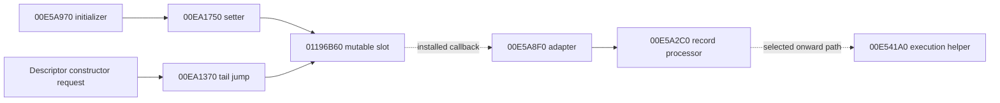

# Runtime-invoke slot installation and constructor requests

PC 1.67 has a concrete internal installation path for its shared runtime-invoke dispatch. `00E5A970` supplies callback address `00E5A8F0` to setter `00EA1750`, which writes the mutable word at `01196B60`. The six-byte thunk `00EA1370` jumps through that word. The installed adapter puts four physical input words into a temporary record and calls processor `00E5A2C0`; the processor eventually reaches internal execution helper `00E541A0` on a selected path.

This establishes an Original static relationship. It does not establish that a live process reached the initializer, which assembly/image/domain was selected, that a constructor completed, or that later code left the slot unchanged. The [central reference](../../evidence/reference.json), [instruction contexts](../../evidence/native/bridge/runtime-invoke-slot/instruction-contexts.json), [data/imports/switch](../../evidence/native/bridge/runtime-invoke-slot/data-imports-and-switch.json), and [installation/record ledger](../../evidence/native/bridge/runtime-invoke-slot/installation-and-record.json) provide the inspectable evidence.

## The setter writes before applying its zero fallback

`00EA1750` reads its first raw stack DWORD, tests it, and stores it at `01196B60` at `00EA1756`. `MOV` preserves the test flags. The following branch skips the fallback for a nonzero input; zero input performs a **second** store of `00EA1360` at `00EA175D`. The 24-byte routine ends in a plain `RET`. This preserves the actual input-then-fallback store order, including the intermediate zero store; no atomic validate-and-install, pointer validity or lifetime guarantee follows.

The Original file value of `01196B60` is also `00EA1360`. That sixteen-byte diagnostic stub calls `00E46E00` with `runtime invoke called on uninitialized runtime` and, **if the diagnostic returns**, clears EAX and returns. The file initializer and diagnostic text are not observations of a loaded process or its current slot.

`00EA1370` is exactly `JMP DWORD PTR [01196B60]`. It has no local namespace, assembly, readiness or null gate. `00EA1680` replaces its first stack word with DWORD[firstWord+0Ch] before tail-jumping through the same slot. Other retained readers prepare different values and perform their own tests; this guide does not impose one source signature or universal precondition on all of them.

The finite absolute-address search identifies sixteen instruction operands using this slot: two stores, two tail jumps and twelve indirect calls. Every selected operand belongs to an Original instruction in the complete retained ranges. Computed-address aliases, external/runtime writers and indirect callers remain outside that predicate. See the [range/source lookup](../../indexes/runtime-invoke-slot.tsv).

## Five callback setters are distinct from initialization success

If preceding callees return normally, the complete 306-byte `00E5A970` body reaches these immediate-source installs in order:

| Push / call | Setter | Destination word | Supplied callback | Zero-input fallback |
| --- | --- | --- | --- | --- |
| `00E5A9D2 / 00E5A9D7` | `00EA0CD0` | `011F55C0` | `00E53360` | None in this setter |
| `00E5A9DC / 00E5A9E1` | `00EA1750` | `01196B60` | `00E5A8F0` | `00EA1360` |
| `00E5A9E6 / 00E5A9EB` | `00EA0CB0` | `01196B58` | `00E53BE0` | `00EA0C60` |
| `00E5A9F0 / 00E5A9F5` | `00EA0C90` | `01196B54` | `00E52290` | `00EA1F20` |
| `00E5A9FA / 00E5A9FF` | `00EA1BC0` | `01196B64` | `00E53A30` | `00EA1B90` |

These supplied words are internal TS3W code addresses. This subset is an individual-callback scheme; it is not evidence of a DLL export-name loader or bulk table install. The five adjacent file words in `[01196B54,01196B68)` also contain the independent `01196B5C = 00EA0C70` initializer, which these five calls do not overwrite. `011F55C0` is a separate virtual zero-fill address with no invented file-backed initial DWORD. Other setup and callback calls remain visible in the full initializer.

Later, `00E76BF0` produces a word which the initializer retains in ESI and returns. Its caller `00D7E9F0` supplies the exact `MonoEngine` string, stores and tests that result, and takes an AL0 early return for zero. The callback stores occur **before** that result producer. A zero initialization result therefore does not prove that no callback was installed or that earlier effects were rolled back. The existing caller is [ASM](../../evidence/native/functions/00D7E9F0_RegisterAllNativeMethodTables.asm) ([C](../../evidence/native/functions/00D7E9F0_RegisterAllNativeMethodTables.c)). Its preserved export status remains separate from the new Original instruction witnesses.

`MonoEngine` is the name/context argument here. It is distinct from the descriptor consumer's `ScriptCore` namespace text and does not by itself identify a loaded assembly or AppDomain.

## The adapter constructs a temporary physical record

The separately preserved callback context `[00E5A8F0,00E5A963)` contains 115 bytes and 24 Original instruction starts through its return. It has no exact retained owner or current function/ABI readback in this package. No function definition, genuine C or canonical pair is fabricated for it.

It reserves 0x150 stack bytes and zeroes that record through the Original `MSVCR80!memset` thunk `00F7F298`. The retained argument pushes remain on the stack until the final cleanup: if entry ESP is S, record base is S−150h; ESP is S−15Ch after the memset call and S−160h after pushing the processor argument. Those offsets establish the following mapping independently of any guessed C prototype:

| Record offset | Physical value |
| --- | --- |
| `+00 / +04 / +08 / +10` | Incoming words 1 / 2 / 3 / 4 |
| `+140`, DWORD | FFFFFFFF |
| `+14A / +14B`, bytes | 1 / 1 |
| `+20`, DWORD | Loaded after the processor and returned in EAX |

The adapter passes one record pointer to `00E5A2C0`, restores ESP with `ADD 160h`, and uses a plain `RET`. The fourth input is stored at record+10h and can be used by the processor as an output destination; the return word at+20h is a separate value. Physical word placement does not recover managed types, object lifetime, general PInvoke ABI or successful execution.

## The processor reaches a concrete internal execution boundary

The full 1,510-byte body of `00E5A2C0` checks record+14Ah before initial method/signature preparation and uses +14Bh to choose temporary-storage paths. The installed adapter sets both bytes to 1. A zero-extended type byte is adjusted by32-bit addition of −2, then compared **unsigned** against 1Bh. Only input bytes 2..29 enter the 28-byte conversion map, which selects nine target DWORDs. All target addresses are starts in the retained processor body; the exact 28 rows and default/scalar/x87 paths are preserved in the data and instruction ledgers. This is a bounded raw conversion switch, not a recovered managed enum or universal marshaling/safety contract.

The retained imports identify `TlsGetValue`, `TlsSetValue`, `printf` and `longjmp`, along with initialization/TLS allocation and memset. On selected paths the processor conditionally stores a produced word through nonnull record+10h and clears record+20h; elsewhere it selects return data from record+38h or helper-produced state. Diagnostic and longjmp paths remain distinct. These instructions do not determine managed exception/object types, thread safety or ownership/lifetime.

At `00E5A76B..00E5A779`, the processor copies record+140h to+144h and passes the record and TLS-derived state to `00E541A0`. That is the next concrete **internal** execution interface. Its retained union is 22,984 bytes in three ranges; the deep VM/opcode contract is still open. The method setup, record preparation, cleanup and result helpers `00E52210`, `00E52F60`, `00E530C0` and `00E52640` also retain separate contract questions.

## A concrete UIManager request reaches the shared slot

The [descriptor/request connection](../../evidence/native/bridge/runtime-invoke-slot/descriptor-request-connection.json) joins three different kinds of fact:

1. On a nonzero allocation, wrapper `00784120` passes literal `UIManager` at `0100FC64` to `00783CD0`. That constructor stores the **unchanged incoming word** at receiver+44h and installs primary table `0100FBBC`; it does not locally duplicate the name. The existing constructor is [ASM](../../evidence/native/functions/00783CD0_FUN_00783cd0.asm) ([C](../../evidence/native/functions/00783CD0_FUN_00783cd0.c)). Table+0Ch selects getter `0060FC70`, whose [ASM](../../evidence/native/functions/0060FC70_GetNativeDescriptorTypeName_Field44.asm) ([C](../../evidence/native/functions/0060FC70_GetNativeDescriptorTypeName_Field44.c)) loads receiver+44h. The generic getter has descriptor meaning only for the demonstrated receiver.
2. If that descriptor reaches the selected `00D7E9F0` loop and its getter returns a nonzero name, the loop passes it with literal namespace `ScriptCore` to `00D7E010`. The helper resolves a type, requests/caches `.ctor()`, and obtains an object word. The namespace argument does not itself establish an assembly: the type lookup uses image-derived words. Failed lookup/object paths and later descriptor callbacks remain distinct.
3. On the nonzero-object path, `00D7E010` initializes a local output word to zero and supplies four physical callee stack words to `00EA1370`: method word, retained object word, zero parameter-array word, and the output-word address. After invocation it checks that output; nonzero takes cleanup/zero return, while zero returns the retained object word. It does **not** treat the invocation's EAX as the constructed object.

This explains how the installed adapter can receive a concrete constructor request. The [published Original constructor evidence](ui-connector-selection.md) separately records `ScriptCore.UIManager` and `ScriptCore.UTFConnectorUIManager` constructors calling `CurrentDomain.SetData("UIManager", this)`. The demonstrated native short name is `UIManager`. Matching spelling and a static invocation path do not prove the live MethodDef, image/domain equality, connector selection, successful construction or binding lifetime.

## Finite frontier and remaining work

The [direct-call frontier](../../evidence/native/bridge/runtime-invoke-slot/direct-call-frontier.json) preserves the actual six literal-DWORD predicates and mapped-executable E8/E9 search. The setter target and initializer target each have one direct candidate, both confirmed Original starts. The callback pointer at `00E5A9DD` is an **operand inside** the `PUSH` at `00E5A9DC`, not another instruction start.

For the shared thunk there are 67 raw direct-transfer candidates. Complete independent Original range decodes confirm 61 starts across 47 historical owners: 52 ranges, 20,112 bytes and 6,588 starts. The six raw sites `00D7F1F3`, `00D7F224`, `00D7F24C`, `00D7F296`, `00D7F32B` and `00E99F41` remain outside retained owner unions. They are unresolved boundary candidates, not newly admitted function bodies or C. The finite caller selection does not prove all argument contracts, dynamic/indirect ingress or actual reachability.

The main installation evidence independently preserves 20 historical definitions in 22 ranges, 5,072 bytes and 1,661 starts, plus the separate adapter context. `00EA3EC0` has three disjoint ranges with eleven excluded envelope bytes. These quantities remain separate from the caller frontier; they are not percentages of understood VM behavior. No canonical pairs or C exports are added here. Current Ghidra ownership, meaningful name/head/variable maintenance and saved annotations remain separate work, as do live initialization, later alias writers, provider lifetime and deep execution semantics. The completed Original selections do not need to be recollected to use this static contract.
