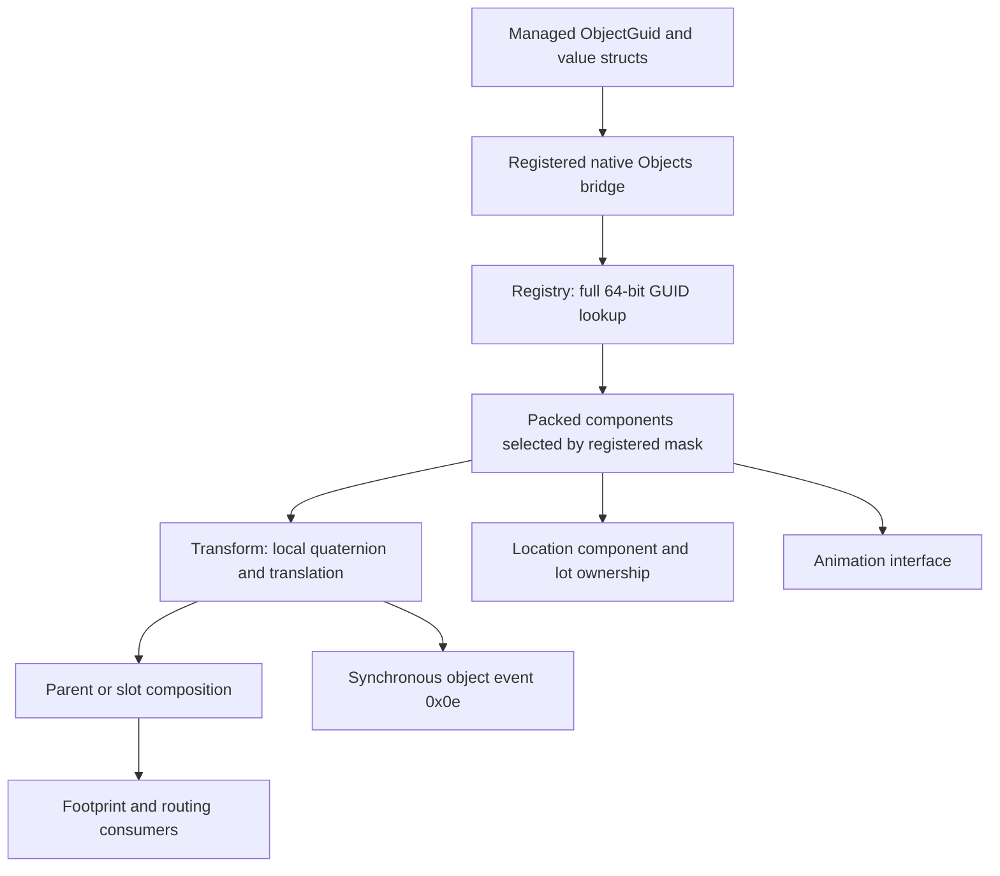

# Object registry, component storage and transform contracts

## Scope and evidence

This guide follows original PC 1.67 `TS3W.exe` from the registered
`ScriptCore.Objects` bridge through the shared object registry, component
producers, transform state, events and spatial ownership. Names such as
`ObjectRegistry_FindBorrowed` are analyst labels. Original descriptor strings
such as `Transform`, `Animation`, `Script`, `Sim` and `Steering` are actual
original data. See the central [binary identity](../../references/retained-proof-overview.md).

The managed inputs come from the retained original
[Objects class](../../evidence/managed/types/ScriptCore.Objects.cs),
[Simulator class](../../evidence/managed/types/ScriptCore.Simulator.cs), and
[original IL](../../evidence/managed/callers.il.txt). Registration identity is in
[API-INDEX.tsv](../../API-INDEX.tsv); managed calls and helper reuse can be
followed through [managed-native-reuse.tsv](../../evidence/bindings/managed-native-reuse.tsv)
and [direct-calls.tsv](../../evidence/native/direct-calls.tsv).

**Static evidence:** the contracts below are checked against instructions,
writers, callers and consumers. **Executed verification:** original byte,
function-envelope, export, link and index comparisons. **Runtime:** no original
game interaction, object creation/destruction, routing or animation test was
executed for this proof. A static failure path is not an observed gameplay bug.



Related detailed contracts:
[Rendered pick selection](rendered-pick-selection.md),
[Painting commands and materials](painting-command-and-materials.md),
[slot resource projection and completion](slot-resource-projection.md),
[footprint queries](footprint-queries.md),
[route destinations and scoring](../routing/destinations-and-scoring.md),
[planner and results](../routing/planner-and-results.md),
[animation controllers](../animation/controller-lifecycle.md), and
[lot levels](../world/lot-level-selection.md).

## 1. Registry identity and ownership

### Global service and hash lookup

`ObjectRegistry_GetGlobal` returns `DAT_011dd350` unchanged. Many registered
bridges immediately use it without a null check: initialized service lifetime
is a precondition of those paths. The service constructor initializes 1,033
bucket heads, a sentinel value `0xffffffff`, the count, 32 descriptor/hash/mask
slots and a reserved zero element in the active-object vector. Activation
publishes the global pointer and registers resource factories; deactivation
clears event listeners before clearing the global pointer.

Evidence: getter [0x00937570 ASM](../../evidence/native/functions/00937570_ObjectRegistry_GetGlobal.asm) ([pseudocode](../../evidence/native/functions/00937570_ObjectRegistry_GetGlobal.c)); constructor [0x00938f30 ASM](../../evidence/native/functions/00938F30_ObjectRegistry_Construct.asm) ([pseudocode](../../evidence/native/functions/00938F30_ObjectRegistry_Construct.c));
activation [0x009372f0 ASM](../../evidence/native/functions/009372F0_ObjectRegistry_Activate.asm) ([pseudocode](../../evidence/native/functions/009372F0_ObjectRegistry_Activate.c)); deactivation [0x00937320 ASM](../../evidence/native/functions/00937320_ObjectRegistry_Deactivate.asm) ([pseudocode](../../evidence/native/functions/00937320_ObjectRegistry_Deactivate.c)).

The hash table starts at registry `+0x10`. `ObjectHash_FindGuid` uses **unsigned**
`DIV 0x409` on the GUID's low 32-bit word to choose a bucket. Equality compares
both object `+0x08` and `+0x0c`; chaining uses `+0x10`. A missing entry produces
an iterator whose node is the sentinel and whose bucket pointer is the sentinel
slot. Registry wrappers compare that sentinel and expose null to callers.
This is full 64-bit identity even though only the low word participates in
bucket selection. Evidence: [0x00937b20 ASM](../../evidence/native/functions/00937B20_ObjectHash_FindGuid.asm) ([pseudocode](../../evidence/native/functions/00937B20_ObjectHash_FindGuid.c)) and [0x00937f80 ASM](../../evidence/native/functions/00937F80_ObjectRegistry_FindBorrowed.asm) ([pseudocode](../../evidence/native/functions/00937F80_ObjectRegistry_FindBorrowed.c)).

| Operation | Inputs and result | Ownership / missing case |
|---|---|---|
| `FindBorrowed` | ECX registry, stack uint64 GUID; pointer in EAX; RET8 | No retain; null when missing |
| `AcquireGuid` | ECX registry, uint64 GUID, output object pointer; RET12 | Success writes output and atomically retains `object+4`; failure AL0 leaves output untouched |
| `IsValid` | Registered managed uint64 input, I1 boolean | Tests borrowed lookup != null; does not add an independent destroyed-state test |

Acquire: [0x00937fc0 ASM](../../evidence/native/functions/00937FC0_ObjectRegistry_AcquireGuid.asm) ([pseudocode](../../evidence/native/functions/00937FC0_ObjectRegistry_AcquireGuid.c)); registered validity: [0x00744bc0 ASM](../../evidence/native/functions/00744BC0_Objects_IsValid.asm) ([pseudocode](../../evidence/native/functions/00744BC0_Objects_IsValid.c)).
High EAX bits in AL-only boolean exits are not part of the result.
A borrowed lookup does not promise that a raw pointer remains valid across
removal. The reviewed retain operation is a separate API.

### GUID producer, insertion and removal

`SelectUnusedGuid` treats requested zero as a generation request; a nonzero ID
already present returns zero; otherwise it keeps the requested value.
`GenerateUnusedGuid` calls the original GUID producer with flag0, checks for
collisions, and invokes the original `004e1830` wait helper with value1 before
retrying. The original generator's entropy/time contract is not established by
this wrapper. Evidence: [0x00938410 ASM](../../evidence/native/functions/00938410_ObjectRegistry_SelectUnusedGuid.asm) ([pseudocode](../../evidence/native/functions/00938410_ObjectRegistry_SelectUnusedGuid.c)) and [0x009380a0 ASM](../../evidence/native/functions/009380A0_ObjectRegistry_GenerateUnusedGuid.asm) ([pseudocode](../../evidence/native/functions/009380A0_ObjectRegistry_GenerateUnusedGuid.c)).

Insertion compares both GUID words. A new node prepends to a bucket and
increments count; a duplicate returns the existing node with inserted-byte0.
The insertion output is `{node, bucketSlot, insertedByte}`; the original
RET12 consumes an additional unused hint word. `AttachObject` retains the
object, inserts it, then dispatches event4. It does not inspect the inserted-byte;
normal creation rejects an existing GUID before this step.
Evidence: [0x00937b90 ASM](../../evidence/native/functions/00937B90_ObjectHash_InsertGuid.asm) ([pseudocode](../../evidence/native/functions/00937B90_ObjectHash_InsertGuid.c)) and [0x00938250 ASM](../../evidence/native/functions/00938250_ObjectRegistry_AttachObject.asm) ([pseudocode](../../evidence/native/functions/00938250_ObjectRegistry_AttachObject.c)).

Removal performs this sequence for a found GUID:

1. Temporary atomic retain.
2. Synchronous event5.
3. Existing owner interface `+0x3c` with `(object, 0)`.
4. Remove from the active-object vector.
5. Set `object+0x28` bit `0x00400000`.
6. Unlink the intrusive node, decrement the table count.
7. Synchronous event6.
8. Release temporary and registry ownership; the deleting destructor runs
   when the respective previous refcount is1.

Evidence: [0x00937e40 ASM](../../evidence/native/functions/00937E40_ObjectRegistry_RemoveGuid.asm) ([pseudocode](../../evidence/native/functions/00937E40_ObjectRegistry_RemoveGuid.c)) and unlink [0x00937720 ASM](../../evidence/native/functions/00937720_ObjectHash_UnlinkNode.asm) ([pseudocode](../../evidence/native/functions/00937720_ObjectHash_UnlinkNode.c)).
The duplicate/missing paths, borrowed lookup and retained lookup are distinct
contracts; removal is not just clearing a GUID slot.

The active vector encodes an index in low bits of `object+0x28`. Index0 is the
reserved entry. Removal uses the low22-bit index, swaps the last object into a
hole, fixes that object's index and clears the removed index. Appending and
marking flags use the registry vector rather than the component pointer array.
Evidence: remove [0x009376c0 ASM](../../evidence/native/functions/009376C0_ObjectRegistry_RemoveActiveObject.asm) ([pseudocode](../../evidence/native/functions/009376C0_ObjectRegistry_RemoveActiveObject.c)); append [0x009393f0 ASM](../../evidence/native/functions/009393F0_ObjectRegistry_AppendActiveObject.asm) ([pseudocode](../../evidence/native/functions/009393F0_ObjectRegistry_AppendActiveObject.c));
mark flags [0x009342d0 ASM](../../evidence/native/functions/009342D0_Object_MarkUpdateFlags.asm) ([pseudocode](../../evidence/native/functions/009342D0_Object_MarkUpdateFlags.c)); clear flags [0x009342b0 ASM](../../evidence/native/functions/009342B0_Object_ClearUpdateFlags.asm) ([pseudocode](../../evidence/native/functions/009342B0_Object_ClearUpdateFlags.c)).
The component-presence field is `+0x2c`, a separate word.

## 2. Component producers and packed storage

### Descriptor registration

The constructor sets `nextMask+0x11c4=1`, `registeredCount+0x11c8=0` and clears
three 32-slot arrays. Registration stores:

| Registry field | Stored value |
|---|---|
| `+0x1044 + index*4` | Descriptor pointer |
| `+0x10c4 + index*4` | Reviewed lowercase FNV1 hash of original descriptor name |
| `+0x1144 + index*4` | Assigned one-bit mask |
| `+0x11c4` | Next mask, shifted left after assignment |
| `+0x11c8` | Count, incremented after assignment |

An optional descriptor `+0x04` callback receives the assigned mask.
There is no local capacity guard in this registration function.
Evidence: [0x00937430 ASM](../../evidence/native/functions/00937430_ObjectRegistry_RegisterComponentType.asm) ([pseudocode](../../evidence/native/functions/00937430_ObjectRegistry_RegisterComponentType.c)). Hash lookup returns the corresponding assigned mask
or zero ([0x00937530 ASM](../../evidence/native/functions/00937530_ObjectRegistry_FindMaskByNameHash.asm) ([pseudocode](../../evidence/native/functions/00937530_ObjectRegistry_FindMaskByNameHash.c))); descriptor lookup chooses the least set bit,
uses index32 for mask0, and returns null when outside registered count
([0x00937610 ASM](../../evidence/native/functions/00937610_ObjectRegistry_GetDescriptorForMask.asm) ([pseudocode](../../evidence/native/functions/00937610_ObjectRegistry_GetDescriptorForMask.c))). Arbitrary multibit arguments are not validated.

The default initializer registers 15 components in a fixed instruction order.
On a fresh registry their masks are `1 << ordinal`, but the code obtains masks
from the registry's current state. The exact original descriptor records,
name strings, factory pointers, sizes, alignments and mask globals are in
[component-descriptors.tsv](../../evidence/objects/component-descriptors.tsv).
Source initializer: [0x00932a30 ASM](../../evidence/native/functions/00932A30_ObjectRegistry_RegisterDefaultComponents.asm) ([pseudocode](../../evidence/native/functions/00932A30_ObjectRegistry_RegisterDefaultComponents.c)).

| Ordinal | Original name | Mask global | Fresh-registry mask |
|---:|---|---|---:|
| 0 | Transform | `0x011ea158` | `0x00000001` |
| 1 | Model | `0x011e9fc4` | `0x00000002` |
| 2 | Animation | `0x011dd484` | `0x00000004` |
| 3 | Script | `0x011ea0f8` | `0x00000008` |
| 4 | Physics | `0x011e9fc8` | `0x00000010` |
| 5 | Effect | `0x011e9e90` | `0x00000020` |
| 6 | Tree | `0x011ea290` | `0x00000040` |
| 7 | Sim | `0x011ea0fc` | `0x00000080` |
| 8 | Steering | `0x011ea138` | `0x00000100` |
| 9 | Sacs | `0x011ea0f0` | `0x00000200` |
| 10 | Slot | `0x011ea114` | `0x00000400` |
| 11 | Lighting | `0x011e9fc0` | `0x00000800` |
| 12 | VisualState | `0x011ea2a8` | `0x00001000` |
| 13 | Footprint | `0x011e9fa8` | `0x00002000` |
| 14 | Audio | `0x011e9e70` | `0x00004000` |

The VisualState descriptor's original name, construction callback and `0x1c`
object size are retained in [original descriptor data](../../evidence/native/visualstate-construction-data.tsv).
Its in-place constructor is cdecl(destination,owner), returns that destination
and performs no allocation. Null returns null without writes. Nonnull stores
the owner at `+4`, vtable `0x01045ac4` at `+0`, initial **DWORD flags `0x939`**
at `+8`, `0xffffffff` at `+0x0c`, zero at `+0x10/+0x14` and binary32 `1.0` at
`+0x18`. The latter uses the already retained `0x00f998f8`
[constant](../../evidence/native/map-view-lot-detail-data.tsv).
These initial fields do not establish subsequent visibility or renderer
notification. [Constructor ASM](../../evidence/native/functions/0095E5B0_VisualState_ConstructInPlace.asm) ([annotated pseudocode](../../evidence/native/functions/0095E5B0_VisualState_ConstructInPlace.c)).

The table's masks are derived from the checked initializer and fresh constructor;
they are not a runtime dump. Components registered elsewhere, including the
Location component used by Objects bridges, are outside that 15-row default
initializer. The original Location descriptor at `0x011855c8` is registered next by
`ObjectRegistry_RegisterGameplayComponents`, which stores assigned mask in `0x011edf08`.
On the fresh registry this is `0x8000`. Location size is `0x38`, alignment8.
Evidence: [0x00c8b2c0 ASM](../../evidence/native/functions/00C8B2C0_ObjectRegistry_RegisterGameplayComponents.asm) ([pseudocode](../../evidence/native/functions/00C8B2C0_ObjectRegistry_RegisterGameplayComponents.c)) and descriptor getter [0x00c892a0 ASM](../../evidence/native/functions/00C892A0_LocationComponent_GetDescriptor.asm) ([pseudocode](../../evidence/native/functions/00C892A0_LocationComponent_GetDescriptor.c)).

### Presence mask and pointer index

`Object_GetComponentByMask(object, requested)` checks
`(objectMask & requested) != 0` and then computes:

```text
packedIndex = popcount(objectMask & (requested - 1))
component = *(object + 0x34 + packedIndex * 4)
```

The original unsigned SHR/SWAR sequence uses `0x55555555`, `0x33333333`,
`0x0f0f0f0f` and `0x01010101`. This counts **present lower bits**, so a component
has no universal fixed pointer-array index. An absent bit yields null.
A present bit with a null packed pointer also yields null. Normal producers pass
one-bit masks; a multibit caller can violate the intended selection contract.
Evidence: [0x00934260 ASM](../../evidence/native/functions/00934260_Object_GetComponentByMask.asm) ([pseudocode](../../evidence/native/functions/00934260_Object_GetComponentByMask.c)).

### Allocation and initialization

The allocation producer establishes the storage that the lookup consumes:

| Object offset | Proven content |
|---|---|
| `+0x00` | Object vtable |
| `+0x04` | Atomic reference count, initialized0 |
| `+0x08/+0x0c` | Full GUID words |
| `+0x10` | Intrusive bucket-chain link |
| `+0x18..+0x24` | Four original source-key words copied from input |
| `+0x28` | Update/index state, initialized0 |
| `+0x2c` | Component-presence mask |
| `+0x30` | Initialized0; broader field meaning unresolved |
| `+0x34...` | One pointer for each set component bit, in increasing-bit order |

Allocation begins with `0x38 + 4*max(popcount(mask)-1, 0)` bytes. It then adds
each descriptor's `+0x1c` size with `+0x20` alignment and uses the largest
alignment, at least8. Components are constructed in increasing-bit order by
calling descriptor `+0x0c(memory, ownerObject)`. A null constructor result leaves
that component pointer null; allocation does not immediately clear its mask.
Evidence: [0x00934cd0 ASM](../../evidence/native/functions/00934CD0_Object_AllocateComponentStorage.asm) ([pseudocode](../../evidence/native/functions/00934CD0_Object_AllocateComponentStorage.c)). Its current pseudocode still contains stack/register
artifacts around the indirect allocator; the original stores at `00934dac..00934de5`
establish GUID, source key and mask fields.

Mask expansion visits initially absent registered bits and calls optional
descriptor `+0x18` dependency predicates with the changing current mask.
It also checks original resource-property hashes: `0x8415534a` adds Animation,
`0x9e2a3b0e` adds Slot, `0x9cc7e9b2` adds Lighting, and two other checked
properties add Footprint. This is one traversal over the initially absent bits;
a recursive fixed-point dependency closure is not established.
Evidence: [0x00937790 ASM](../../evidence/native/functions/00937790_Object_ExpandComponentMask.asm) ([pseudocode](../../evidence/native/functions/00937790_Object_ExpandComponentMask.c)).

Creation resolves the requested GUID, expands the mask, allocates components,
temporarily retains the object, and initializes each component through its
vtable `+0x04`. The first false AL result stops initialization; otherwise event0
is dispatched. Success then attaches to the registry/event4 and releases the
temporary reference. Failure dispatches event6 and releases the temporary
object. Inputs are ECX registry plus stack resource pointer, base mask,
source-key pointer and packed64 requested GUID; RET0x14.
Evidence: [0x00938c00 ASM](../../evidence/native/functions/00938C00_ObjectRegistry_CreateInitializedObject.asm) ([pseudocode](../../evidence/native/functions/00938C00_ObjectRegistry_CreateInitializedObject.c)) and [0x009343d0 ASM](../../evidence/native/functions/009343D0_Object_InitializeComponents.asm) ([pseudocode](../../evidence/native/functions/009343D0_Object_InitializeComponents.c)).

The managed `Simulator.CreateObject` separately produces an override-data
buffer: int32 count; entries grouped by string/resource-key/uint values; each
entry has a byte tag, byte key length and ASCII key, followed by the type's
payload. Resource-key payload is instance64, group32, type32. It passes
`MemoryStream.GetBuffer()` rather than a trimmed buffer, or null when no
overrides are supplied. The registered native create/destroy bridges delegate
through global interface `+0x17c`, then returned interface `+4`/`+0x0c`.
Those indirect implementations are not assumed to be the registry routines
above without a concrete vtable binding.
Managed [producer](../../evidence/managed/types/ScriptCore.Simulator.cs);
create bridge [0x0076d1a0 ASM](../../evidence/native/functions/0076D1A0_ScriptCore_Simulator_Simulator_CreateObjectImpl.asm) ([pseudocode](../../evidence/native/functions/0076D1A0_ScriptCore_Simulator_Simulator_CreateObjectImpl.c)); destroy bridge [0x0076d1e0 ASM](../../evidence/native/functions/0076D1E0_ScriptCore_Simulator_Simulator_DestroyObjectImpl.asm) ([pseudocode](../../evidence/native/functions/0076D1E0_ScriptCore_Simulator_Simulator_DestroyObjectImpl.c)).

## 3. Transform state, parent composition and notification

### Producer and layout

The original Transform descriptor has size `0x40`, alignment `0x10` and name
`Transform`. Its factory accepts `(memory, ownerObject)` and invokes a concrete
constructor with ECX memory; null memory returns null. The constructor starts
with identity quaternion `(0,0,0,1)`, zero translation including W, null parent,
and **flags=1**, then clears its owner's registered update bit.
Evidence: descriptor [0x00955ec0 ASM](../../evidence/native/functions/00955EC0_TransformComponent_GetDescriptor.asm) ([pseudocode](../../evidence/native/functions/00955EC0_TransformComponent_GetDescriptor.c)); factory [0x00958d70 ASM](../../evidence/native/functions/00958D70_TransformComponent_ConstructInPlace.asm) ([pseudocode](../../evidence/native/functions/00958D70_TransformComponent_ConstructInPlace.c));
constructor [0x00957c60 ASM](../../evidence/native/functions/00957C60_TransformComponent_Construct.asm) ([pseudocode](../../evidence/native/functions/00957C60_TransformComponent_Construct.c)).

| Transform offset | Proven content / use |
|---|---|
| `+0x04` | Owner object pointer |
| `+0x08` | Initialized0 |
| `+0x10..+0x1c` | Local quaternion XYZW |
| `+0x20..+0x2c` | Local translation four-lane vector |
| `+0x30` | Parent object; null takes direct local path |
| `+0x34` | State flags; bits1/2 trigger refresh, bit4 suppresses normal notifications |

World getters compose local pose with the parent/slot pose. The parent resolver
uses Slot component binding and relative/absolute slot transforms, so the parent
path is richer than a parent object's translation alone. See
[the exact getters and slot composition](footprint-queries.md)
and getter [0x00957910 ASM](../../evidence/native/functions/00957910_TransformComponent_GetWorldQuaternionTranslation.asm) ([pseudocode](../../evidence/native/functions/00957910_TransformComponent_GetWorldQuaternionTranslation.c)), parent resolver [0x00956f90 ASM](../../evidence/native/functions/00956F90_TransformComponent_GetParentSlotQuaternionTranslation.asm) ([pseudocode](../../evidence/native/functions/00956F90_TransformComponent_GetParentSlotQuaternionTranslation.c)),
position getter [0x00957a30 ASM](../../evidence/native/functions/00957A30_TransformComponent_GetWorldPosition.asm) ([pseudocode](../../evidence/native/functions/00957A30_TransformComponent_GetWorldPosition.c)).

### Local and world setter differences

Constants and original words are in
[transform-constants.tsv](../../evidence/objects/transform-constants.tsv).
The component-change epsilon is exactly `2^-16` (`1.52587890625e-5`).

| Setter | Unchanged test | Parent / validation behavior |
|---|---|---|
| Local position | Absolute XYZ delta <= epsilon; W excluded | Requires ordered finite XYZ range before writing; calls large-displacement notification |
| World position | No parent uses local setter; parent path compares converted local XYZ | Parent pose inversion, direct local store; does not call local range/large-displacement helpers |
| Local quaternion | Aligns comparison hemisphere using W sign; sum of four squared deltas <= epsilon² | Stores original input bits if changed; no normalization |
| World quaternion | Delegates local quaternion comparison | Inverse parent quaternion times requested world quaternion |
| Local pose | All four absolute quaternion deltas <= epsilon and XYZ translation deltas <= epsilon | No hemisphere alignment and no local-position range helper |
| World pose | Converts to local pose when parent present | Inverse parent rotation and translation, then local-pose setter |
| World matrix | Converts 3x3 to quaternion with trace/major-diagonal branches and copies fourth-row translation | Calls world-pose setter; stored component is quaternion+translation, not arbitrary scale/shear matrix |

Local/world position: [0x00958330 ASM](../../evidence/native/functions/00958330_TransformComponent_SetLocalPosition.asm) ([pseudocode](../../evidence/native/functions/00958330_TransformComponent_SetLocalPosition.c)) and [0x009583b0 ASM](../../evidence/native/functions/009583B0_TransformComponent_SetWorldPosition.asm) ([pseudocode](../../evidence/native/functions/009583B0_TransformComponent_SetWorldPosition.c)).
Local/world quaternion: [0x00958550 ASM](../../evidence/native/functions/00958550_TransformComponent_SetLocalQuaternion.asm) ([pseudocode](../../evidence/native/functions/00958550_TransformComponent_SetLocalQuaternion.c)) and [0x00958610 ASM](../../evidence/native/functions/00958610_TransformComponent_SetWorldQuaternion.asm) ([pseudocode](../../evidence/native/functions/00958610_TransformComponent_SetWorldQuaternion.c)).
Local/world pose: [0x009580a0 ASM](../../evidence/native/functions/009580A0_TransformComponent_SetLocalPose.asm) ([pseudocode](../../evidence/native/functions/009580A0_TransformComponent_SetLocalPose.c)) and [0x00958150 ASM](../../evidence/native/functions/00958150_TransformComponent_SetWorldPose.asm) ([pseudocode](../../evidence/native/functions/00958150_TransformComponent_SetWorldPose.c)).
Matrix: [0x00958760 ASM](../../evidence/native/functions/00958760_TransformComponent_SetWorldMatrix.asm) ([pseudocode](../../evidence/native/functions/00958760_TransformComponent_SetWorldMatrix.c)).

The trace uses two separate float-lane additions: `m11 + m00` at0095878B,
then `m22 + (m11 + m00)` at00958795. The positive-trace branch adds1 to that
stored trace at009587E7. Ordinary left-associative expressions printed in the
decompiler are reassociation artifacts; they do not preserve these rounding
boundaries. Ambient SSE state remains relevant, and no numeric test is claimed.
[ASM](../../evidence/native/functions/00958760_TransformComponent_SetWorldMatrix.asm) ([annotated pseudocode](../../evidence/native/functions/00958760_TransformComponent_SetWorldMatrix.c))

The parent's quaternion inverse uses conjugate divided by squared norm:
`RCPPS` followed by two reciprocal refinement steps (`r = r*(2 - norm*r)`).
No explicit zero-norm guard is visible in those setters. SIMD shuffles and
four-lane operations must be checked against original instructions; a
high-level normalized quaternion replacement is not justified here.

### World quaternion to matrix

The matrix getter has ECX Transform plus one output pointer, RET4, and returns
that same pointer in EAX. It calls the reviewed world quaternion/translation
producer using aligned scratch, then writes four MOVAPS rows. The output must
provide **16-byte-aligned 64-byte storage**.
[Getter ASM](../../evidence/native/functions/00957A90_TransformComponent_GetWorldMatrix.asm) ([annotated pseudocode](../../evidence/native/functions/00957A90_TransformComponent_GetWorldMatrix.c));
[pose producer ASM](../../evidence/native/functions/00957910_TransformComponent_GetWorldQuaternionTranslation.asm) ([annotated pseudocode](../../evidence/native/functions/00957910_TransformComponent_GetWorldQuaternionTranslation.c)).

Let `fl` preserve each original SSE instruction's rounding under ambient MXCSR,
`s` be binary32 word `0x3fb504f3`, and `(a,b,c,d)=fl(s*(x,y,z,w))`.
For each lane `h=fl(fl(fl(0-r)*r)+0.5)`. Each product inside the following
table is separately rounded before its add/subtract; each cell's final operation
is also rounded. There is no normalization, finite guard or fused operation in
this getter. The exact [constant words](../../evidence/objects/transform-constants.tsv)
take precedence over a reassociated conventional `2*q` formula.

| Output row | First three float lanes |
| --- | --- |
| 0 | `hz+hy`, `dc+ba`, `ac-db` |
| 1 | `ba-dc`, `hx+hz`, `da+cb` |
| 2 | `db+ac`, `cb-da`, `hy+hx` |
| 3 | `translationX`, `translationY`, `translationZ` |

Rows0–2 use ANDPS against global `0x011b0670`. Its selected initializer writes
`{0xffffffff,0xffffffff,0xffffffff,0}`. After that initialization, the first
three float **bit patterns** survive unchanged and each fourth lane becomes
positive zero. Row3's fourth lane is exact `1.0`; the input translation fourth
lane is ignored. The static database's zero-filled global does not describe
its initialized runtime value. The original
[initializer pointer cell](../../evidence/objects/transform-simd-initializer.tsv)
references this writer; complete startup ordering and future computed writes
are not established here.
[Initializer ASM](../../evidence/native/functions/00F80590_SimdMasks_InitializeXyzKeepMask.asm) ([annotated pseudocode](../../evidence/native/functions/00F80590_SimdMasks_InitializeXyzKeepMask.c)).

Ghidra's numeric-looking float/UInt32 casts around these masks represent
bit reinterpretation, not CVT/CVTT conversions. The exported actual C is retained
with that warning. Ambient rounding/FTZ/DAZ behavior and compiled reconstruction
equivalence require separate checks; no numeric or runtime test was executed.

The local position finite-range helper compares inclusive minimum/maximum in
XYZ, reducing the three ordered CMPLEPS results; W does not participate. Static
initializers broadcast `-FLT_MAX` and `+FLT_MAX` to the bound vectors. Thus NaN
and either infinity fail this local gate, while finite representable XYZ falls
inside the initial limits. This describes initial bound values and the helper,
not an observed runtime movement restriction.
Helper [0x00955f40 ASM](../../evidence/native/functions/00955F40_TransformComponent_PositionWithinFiniteRange.asm) ([pseudocode](../../evidence/native/functions/00955F40_TransformComponent_PositionWithinFiniteRange.c)); minimum initializer [0x00f8ab00 ASM](../../evidence/native/functions/00F8AB00_TransformBounds_InitializeMinimum.asm) ([pseudocode](../../evidence/native/functions/00F8AB00_TransformBounds_InitializeMinimum.c));
maximum initializer [0x00f8ab20 ASM](../../evidence/native/functions/00F8AB20_TransformBounds_InitializeMaximum.asm) ([pseudocode](../../evidence/native/functions/00F8AB20_TransformBounds_InitializeMaximum.c)).

The pre-store large-position helper requires Sim and Model components and
squared XYZ displacement greater than100. It compares old/new bounds through
two distinct geometry predicates. A particular true-to-false transition sets
an owner component bit `0x10000` and dispatches numeric hashes `0xecff5d63`
and `0x7727ad2e`. Those event names and the full geometry predicate semantics
remain unresolved. Evidence: [0x009561a0 ASM](../../evidence/native/functions/009561A0_TransformComponent_NotifyLargePositionChange.asm) ([pseudocode](../../evidence/native/functions/009561A0_TransformComponent_NotifyLargePositionChange.c)).

### Event producer and consumer

Normal pose-change notification skips when Transform flag4 is set; otherwise
it refreshes derived state when flags1/2 are set and dispatches object event
`0x0e` with a stack-local 32-byte composed world pose. This is synchronous;
consumers cannot retain the temporary payload pointer after dispatch.
Evidence: [0x00957be0 ASM](../../evidence/native/functions/00957BE0_TransformComponent_NotifyPoseChanged.asm) ([pseudocode](../../evidence/native/functions/00957BE0_TransformComponent_NotifyPoseChanged.c)).

Object event registration allocates `{signedPriority, callback, next}` nodes
and inserts in descending priority, following existing equal-priority nodes.
Dispatch calls `(object,payload)` until a callback's AL is false. The 42-head
object event table is distinct from managed `WorldEvent` numbering.
Registration [0x009355f0 ASM](../../evidence/native/functions/009355F0_ObjectEvents_RegisterListener.asm) ([pseudocode](../../evidence/native/functions/009355F0_ObjectEvents_RegisterListener.c)); dispatch [0x009356c0 ASM](../../evidence/native/functions/009356C0_ObjectEvents_Dispatch.asm) ([pseudocode](../../evidence/native/functions/009356C0_ObjectEvents_Dispatch.c));
listener cleanup [0x00935670 ASM](../../evidence/native/functions/00935670_ObjectEvents_ClearListeners.asm) ([pseudocode](../../evidence/native/functions/00935670_ObjectEvents_ClearListeners.c)).

Transform's descriptor callback registers listeners at object events6, `0x12`
and4, then allocates separate high-byte object update bits. The assigned
component mask is stored by the initializer, not this callback.
The Location descriptor registers a pose event `0x0e` listener with priority50.
It resolves Location and passes world-pose payload+0x10, the world translation,
to its position-update routine. That routine gates on owner hidden flags,
world registry and Transform, tries a specialized location path then fallback,
and conditionally updates caches/dispatches notifications. Its deeper level,
room and change-flag taxonomy remains open. This is a concrete consumer of
Transform pose events. Location registration [0x00c8b240 ASM](../../evidence/native/functions/00C8B240_LocationComponent_RegisterEvents.asm) ([pseudocode](../../evidence/native/functions/00C8B240_LocationComponent_RegisterEvents.c)); listener
[0x00c8b210 ASM](../../evidence/native/functions/00C8B210_LocationComponent_OnWorldPoseChanged.asm) ([pseudocode](../../evidence/native/functions/00C8B210_LocationComponent_OnWorldPoseChanged.c)); position consumer [0x00c8abe0 ASM](../../evidence/native/functions/00C8ABE0_LocationComponent_UpdateForWorldPosition.asm) ([pseudocode](../../evidence/native/functions/00C8ABE0_LocationComponent_UpdateForWorldPosition.c)).

Callback [0x0095a100 ASM](../../evidence/native/functions/0095A100_TransformComponent_RegisterEvents.asm) ([pseudocode](../../evidence/native/functions/0095A100_TransformComponent_RegisterEvents.c)); two flag allocators [0x00937690 ASM](../../evidence/native/functions/00937690_ObjectRegistry_AllocateUpdateFlag.asm) ([pseudocode](../../evidence/native/functions/00937690_ObjectRegistry_AllocateUpdateFlag.c))
and [0x00937670 ASM](../../evidence/native/functions/00937670_ObjectRegistry_AllocateTransientUpdateFlag.asm) ([pseudocode](../../evidence/native/functions/00937670_ObjectRegistry_AllocateTransientUpdateFlag.c)).

- Event4 resolves Transform and performs normal pose notification; returnsAL1.
  Listener [0x00958d40 ASM](../../evidence/native/functions/00958D40_TransformComponent_OnObjectAttached.asm) ([pseudocode](../../evidence/native/functions/00958D40_TransformComponent_OnObjectAttached.c)); handler [0x00957ce0 ASM](../../evidence/native/functions/00957CE0_TransformComponent_NotifyObjectAttached.asm) ([pseudocode](../../evidence/native/functions/00957CE0_TransformComponent_NotifyObjectAttached.c)).
- Event6 resolves Transform, invokes removal helpers and returnsAL1.
  Listener [0x0095a0d0 ASM](../../evidence/native/functions/0095A0D0_TransformComponent_OnObjectRemoved.asm) ([pseudocode](../../evidence/native/functions/0095A0D0_TransformComponent_OnObjectRemoved.c)); handler [0x0095a0a0 ASM](../../evidence/native/functions/0095A0A0_TransformComponent_HandleObjectRemoval.asm) ([pseudocode](../../evidence/native/functions/0095A0A0_TransformComponent_HandleObjectRemoval.c)).
- Event `0x12` forwards a consumed but unused payload; its handler dispatches
  composed pose event `0x0e` without the normal flag4 suppression, returningAL1.
  Listener [0x00957c30 ASM](../../evidence/native/functions/00957C30_TransformComponent_OnEvent18.asm) ([pseudocode](../../evidence/native/functions/00957C30_TransformComponent_OnEvent18.c)); handler [0x00957b60 ASM](../../evidence/native/functions/00957B60_TransformComponent_ForwardPoseEvent.asm) ([pseudocode](../../evidence/native/functions/00957B60_TransformComponent_ForwardPoseEvent.c)).

`TransformComponent_MarkDerivedStateDirty` marks the owner with the registered
update flag and ORs Transform flag2. Its position relative to writes differs
between the three native setters below. Evidence: [0x00955ed0 ASM](../../evidence/native/functions/00955ED0_TransformComponent_MarkDerivedStateDirty.asm) ([pseudocode](../../evidence/native/functions/00955ED0_TransformComponent_MarkDerivedStateDirty.c)).

## 4. Managed bridge inputs, outputs and spatial effects

### Return buffers and missing objects

`Objects_GetTransform` uses a first stack output-buffer pointer followed by a
packed64 GUID. Valid Transform returns the composed world matrix through four
row conversions; missing object/component writes identity Matrix44.
`Objects_GetPosition` has the same return-buffer pattern with Vector3 and writes
zero XYZ on a missing object/component. EAX returns the caller buffer. These
are struct-return ABIs, not APIs whose only meaningful input is an output
pointer. Evidence: [0x00744c70 ASM](../../evidence/native/functions/00744C70_ScriptCore_Objects_Objects_GetTransform.asm) ([pseudocode](../../evidence/native/functions/00744C70_ScriptCore_Objects_Objects_GetTransform.c)) and [0x00744fa0 ASM](../../evidence/native/functions/00744FA0_ScriptCore_Objects_Objects_GetPosition.asm) ([pseudocode](../../evidence/native/functions/00744FA0_ScriptCore_Objects_Objects_GetPosition.c)).

`Objects_GetLocation` instead has three explicit output pointers. A found
Location component supplies lot64 from `+8/+0x0c`, signed level32 from `+0x18`,
and room32 from `+0x20`. Missing object/component leaves all outputs untouched;
there is no native initialization to default values in this wrapper.
Evidence: [0x007453c0 ASM](../../evidence/native/functions/007453C0_Objects_GetLocation.asm) ([pseudocode](../../evidence/native/functions/007453C0_Objects_GetLocation.c)).

The verified native stack layout packs the 64-bit GUID without extra 8-byte
padding. Ghidra parameter storage was assigned from original stack loads and
RET values. Generic parameter allocation that inserts padding after a pointer
or three 32-bit arguments misidentifies the GUID words. Actual annotated C may
still contain artifacts around indirect host allocator calls; those expressions
are identified in its function comment and do not override the original ASM.

### Position, rotation and transform have different side effects

| Bridge | Before pose mutation | Pose mutation | After mutation |
|---|---|---|---|
| `SetPosition(id, Vector3)` | Animation interface `+0x28`, or Transform dirty fallback; compare requested world XYZ exactly and clear Location flag0x80 if changed | Expand Vector3 to four lanes; world-position setter | Conditional spatial/lot refresh; selected lot notification; Steering interface `+0x34` |
| `SetRotation(id, radians)` | Same animation/dirty preparation; set Location flag0x10 | Y-axis quaternion `(0,sin(angle/2),0,cos(angle/2))`; world-quaternion setter | Conditional spatial/lot refresh and lot notification; Steering interface `+0x38` |
| `SetTransform(id, Matrix44)` | Four row conversions; clear Location flag0x80 | World-matrix setter | Animation interface `+0x28`, or Transform dirty fallback |

Position [0x00745020 ASM](../../evidence/native/functions/00745020_ScriptCore_Objects_Objects_SetPosition.asm) ([pseudocode](../../evidence/native/functions/00745020_ScriptCore_Objects_Objects_SetPosition.c)); rotation [0x00745520 ASM](../../evidence/native/functions/00745520_ScriptCore_Objects_Objects_SetRotation.asm) ([pseudocode](../../evidence/native/functions/00745520_ScriptCore_Objects_Objects_SetRotation.c));
transform [0x00744d80 ASM](../../evidence/native/functions/00744D80_ScriptCore_Objects_Objects_SetTransform.asm) ([pseudocode](../../evidence/native/functions/00744D80_ScriptCore_Objects_Objects_SetTransform.c)). Registered values are by-value Vector3/Matrix44,
not pointers to managed structs. All are managed void operations.

The Position spatial path requires no Sim component and either no Steering
component or a false result from its tested predicate. When XYZ changed it
captures the original owner, resolves current ownership and only emits the
reviewed lot-location notification when the resulting owner is non-null and
**equal to** the captured owner. Original `CMP EDI,EAX; JNZ skip` at
`00745191..00745193` establishes equality; the branch must not be described as
an owner-change notification. With unchanged XYZ it can still refresh ownership.
Rotation has its own gating and does not use Position's exact-delta comparison.

`LocationComponent_ResolveAndSetOwningLot` accepts an explicit lot; otherwise it
gets the owner's composed world position, applies the world registry's
half-open XZ bounds, looks up a containing lot, and may use the default lot.
It delegates state changes to `LocationComponent_SetOwningLot`.
Resolver [0x00c8b0b0 ASM](../../evidence/native/functions/00C8B0B0_LocationComponent_ResolveAndSetOwningLot.asm) ([pseudocode](../../evidence/native/functions/00C8B0B0_LocationComponent_ResolveAndSetOwningLot.c)); owner setter [0x00c8aea0 ASM](../../evidence/native/functions/00C8AEA0_LocationComponent_SetOwningLot.asm) ([pseudocode](../../evidence/native/functions/00C8AEA0_LocationComponent_SetOwningLot.c)).

The owner setter has Sim/Steering gates that may select the default lot, calls
old-owner removal and new-owner addition virtuals, updates the full lot ID,
updates spatial membership and recursively applies the owner to attached Slot
children. It therefore carries more state than a lot-GUID write. Exact meanings
of all Steering fields/predicates and the lower spatial-index algorithms remain
open. The reviewed lot-location notifier carries the object's full GUID and
numeric operation2 through its host callback. Notifier: [0x00acd210 ASM](../../evidence/native/functions/00ACD210_Lot_NotifyObjectLocationChanged.asm) ([pseudocode](../../evidence/native/functions/00ACD210_Lot_NotifyObjectLocationChanged.c)).

Pre-leaving and post-reaching wrappers look up Location, then tailcall separate
handlers. Missing object/component is a no-op. The handlers pass owner `+4` to
lot routines that resolve a lot from the source key and invoke different
pre/post helper pairs. Those lower helpers are not assigned broader rebuild
semantics here. Pre wrapper [0x00745240 ASM](../../evidence/native/functions/00745240_Objects_DoPreLeavingValidSpatialConfiguration.asm) ([pseudocode](../../evidence/native/functions/00745240_Objects_DoPreLeavingValidSpatialConfiguration.c)), component handler [0x00c89660 ASM](../../evidence/native/functions/00C89660_LocationComponent_PreLeavingConfiguration.asm) ([pseudocode](../../evidence/native/functions/00C89660_LocationComponent_PreLeavingConfiguration.c)),
lot handler [0x00b0ee00 ASM](../../evidence/native/functions/00B0EE00_LotObject_PreLeavingConfiguration.asm) ([pseudocode](../../evidence/native/functions/00B0EE00_LotObject_PreLeavingConfiguration.c)). Post wrapper [0x00745280 ASM](../../evidence/native/functions/00745280_Objects_DoPostReachingValidSpatialConfiguration.asm) ([pseudocode](../../evidence/native/functions/00745280_Objects_DoPostReachingValidSpatialConfiguration.c)),
component handler [0x00c89670 ASM](../../evidence/native/functions/00C89670_LocationComponent_PostReachingConfiguration.asm) ([pseudocode](../../evidence/native/functions/00C89670_LocationComponent_PostReachingConfiguration.c)), lot handler [0x00b0edb0 ASM](../../evidence/native/functions/00B0EDB0_LotObject_PostReachingConfiguration.asm) ([pseudocode](../../evidence/native/functions/00B0EDB0_LotObject_PostReachingConfiguration.c)).

## 5. Cross-system consumers and remaining boundaries

- Routing destination expansion and transform lookup use the same full-GUID
  registry and packed component masks. A missing object and a missing required
  component must stay distinguishable in each route result.
- Animation's registered Animation descriptor is the same `011dd484` selected
  by Objects' pre/post mutation interface calls. Controller attachment,
  resource binding, queue/immediate play, elapsed lifetime and completion are
  described in the [animation guide](../animation/controller-lifecycle.md).
- Footprints consume composed world transforms and Slot parent state. Script,
  Sim and Footprint component presence gates are separate from runtime polygon
  enabled flags and the managed HandTool exclusion callback. See
  [footprint queries](footprint-queries.md).
- Managed Simulator override production is established, but its host vtable
  targets are not silently equated with every native registry creation path.
- This proof does not establish complete object persistence, every component
  virtual, all spatial rebuilds, concurrency policy, parent detach/cycle policy,
  the GUID generator, or runtime validity during every destruction callback.
  Full engine parity needs those remaining producer/consumer contracts and
  original runtime evidence.

## Function coverage

The 75 focused object/component/transform/spatial exports in this guide's scope
are complete original instruction envelopes and actual annotated Ghidra C.
Shared world getters are documented in the Footprint scope. The canonical
[code index](../../evidence/native/code-index.tsv) records current names and
bounds; the [annotation index](../../evidence/native/annotation-index.json)
records corrected storage-aware prototypes. Those are lookup references,
not investigation journals. No original executable bytes were changed.

## Wall-mounted visibility

The [wall-mounted visibility contract](../world/wall-mounted-object-visibility.md) follows wall/level message producers through catalog and locator gates, mode/room exceptions, VisualState mask `0x8`, synchronous object notifications and selected model/effect/tree/physics/slot consumers.

The separate [opacity and color transition contract](opacity-and-color-transitions.md) distinguishes requested VisualState targets from renderer interpolation and effective alpha.


### Registered component dependency predicates

The existing [original descriptor records](../../evidence/objects/component-descriptors.tsv)
point to four dependency predicates through descriptor offset `+0x18`. They take
one stack DWORD component mask with caller stack cleanup. They read the current
registered component mask globals; the numeric bit values follow registration
rather than being independent wire constants.

| Dependent descriptor | Input mask predicate | Original code |
| --- | --- | --- |
| Slot and Audio | Has Transform (`011EA158`) | [00941F00 ASM](../../evidence/native/functions/00941F00_ComponentDependency_HasTransform.asm) ([annotated C](../../evidence/native/functions/00941F00_ComponentDependency_HasTransform.c)) |
| VisualState | Has any Effect (`011E9E90`), Model (`011E9FC4`) or Script (`011EA0F8`) | [0095DBC0 ASM](../../evidence/native/functions/0095DBC0_VisualStateDependency_HasVisualSource.asm) ([annotated C](../../evidence/native/functions/0095DBC0_VisualStateDependency_HasVisualSource.c)) |
| Footprint | Has Sim (`011EA0FC`) | [00944940 ASM](../../evidence/native/functions/00944940_FootprintDependency_HasSim.asm) ([annotated C](../../evidence/native/functions/00944940_FootprintDependency_HasSim.c)) |
| Location | Has Transform (`011EA158`) | [00C892F0 ASM](../../evidence/native/functions/00C892F0_LocationDependency_HasTransform.asm) ([annotated C](../../evidence/native/functions/00C892F0_LocationDependency_HasTransform.c)) |

The first three use `TEST; SETNE AL`, so only the low result byte is the Boolean;
upper EAX bits are not a Boolean result. Location instead uses
`AND; NEG; SBB EAX,EAX; NEG`, returning full EAX zero or one. None writes fields,
loads a resource or constructs a component.

The existing mask-expansion caller tests AL, adds the selected bit, then advances
through its initially absent descriptor bits once. These predicates cannot add
Transform, Model, Script, Effect or Sim themselves, so their reviewed implications
do not require another pass in this descriptor set. This does not establish a
recursive fixed point for arbitrary later registrations.
[Caller ASM](../../evidence/native/functions/00937790_Object_ExpandComponentMask.asm) ([annotated C](../../evidence/native/functions/00937790_Object_ExpandComponentMask.c))

## Finalized component parameters

The [complete parameter contract](finalized-component-parameters.md) covers override/default append order, descriptor and payload storage, unsigned hash sorting and exact-type lookup. Small valid tables preserve equal-hash input order; larger partitions can exchange equal hashes. Animation checks finalized type4 presence independently of payload zero, while VisualState reads type5 words. Native record kind and managed wire tag remain distinct, with wire production still unresolved.

## Object-light resource and controls

The [original light-control contract](object-light-controls.md) retains the paired versioned component stream, resource-key parameter initialization, command packet shapes and object RGB/dimmer consumers. Resource/control command acceptance and local AL1 are distinct from completed source loading or rendering. The scalar dimmer update has an ordered strict binary32 threshold; RGB replacement preserves a separate four-lane source/control distinction. Complete LITE construction, spatial placement and downstream intensity remain separate.


## Location room state and event order

The uncontained Location updater C8A810 resolves the actual owning lot and keeps
distinct loaded-row flag80 and recomputed height/local-point paths. A cleared
Location has lot0, signed level7FFFFFFF and roomFFFFFFFF. The room path calls
B482C0 with PlacementBlocking lane2 and outsideflag0; B482C0 encodes the full
fractional local position with AF7DB0 and queries C03FC0. This is not the integer
public room query. The exact terrain-height producer, all native gates and flag
taxonomy remain open.
[Uncontained updater ASM](../../evidence/native/functions/00C8A810_LocationComponent_ResolveUncontainedWorldPosition.asm)
([annotated pseudocode](../../evidence/native/functions/00C8A810_LocationComponent_ResolveUncontainedWorldPosition.c));
[point query ASM](../../evidence/native/functions/00B482C0_LotRoom_ResolveForLocalLocation.asm)
([annotated pseudocode](../../evidence/native/functions/00B482C0_LotRoom_ResolveForLocalLocation.c)).

C8ABE0 tests its actual owner/Transform/world and hidden/model flags, selects the
special C8A550 or uncontained C8A810 operation, and can notify old-lot readiness
with operation0B. When change flags3C are present it calls C8A200's managed
event17 path before C89A20's native index transition. A local return is not an
atomic callback/index transaction and does not prove complete script-host error
containment or rollback.
[Location refresh ASM](../../evidence/native/functions/00C8ABE0_LocationComponent_UpdateForWorldPosition.asm)
([annotated pseudocode](../../evidence/native/functions/00C8ABE0_LocationComponent_UpdateForWorldPosition.c));
[managed-event producer ASM](../../evidence/native/functions/00C8A200_LocationComponent_NotifyManagedLotUpdate.asm)
([annotated pseudocode](../../evidence/native/functions/00C8A200_LocationComponent_NotifyManagedLotUpdate.c)).
Existing canonical owned exports are reused even though the current database
metadata for C8ABE0 is undefined; no fresh body ownership is asserted.

C8A200 builds the four actual argument variants: object GUID64, lot GUID64,
level32 and room32. A Script-interface mask11EA0F8 gate precedes event17 dispatch;
variant cleanup follows its native path. Retail managed
`Sims3.SimIFace.World.OnObjectLotUpdate(ulong,ulong,int,int)` token060005C9 has
signature blob0004010b0b0808 and body RVA00009B57. Its
[reviewed IL](../../evidence/managed/world-object-lot-update.il.json) pairs with
the existing [managed decompilation](../callbacks/managed/Sims3.SimIFace.World.cs)
member. IL0000..0024 checks sOnObjectLotUpdateEventHandler; only a nonnull handler
causes gWorld.GetType(), creation of OnObjectLotUpdateEventArgs with all four
arguments and delegate Invoke. There is no local EH region. Native Script gating,
managed handler gating and any outer exception host are separate boundaries.

This IL was read through the installed ILSpy library and checked against the
retail method-body bytes. Provenance: scripts.package, S3SA
073FAA07:00000000:C356DF69B70ADD42, SimIFace version1.0.0.50,
MVIDe4365bd8-6054-4cb5-8702-c69b1c102ce9,
SHA2566ddedb668e1b6da037e346cd5cf6f500f37407dca633b428e7ec410daa00fcb2.
The current package hash is
1fc5e1a7a43c4019595c817631efc9bb5bc3bdfd3925a2a3a65783ad8229a76c.
No mod, retargeted or arbitrary loose assembly is used as original authority.
Subscribers, variant/reference ownership, reentry/suspension and complete native
Location/index lifecycle remain open. See the existing
[room guide](../construction/room-manager-grid-original-reader.md#fractional-room-point-during-object-membership-refresh)
for the manager/local-point producer. No original runtime execution is claimed.
