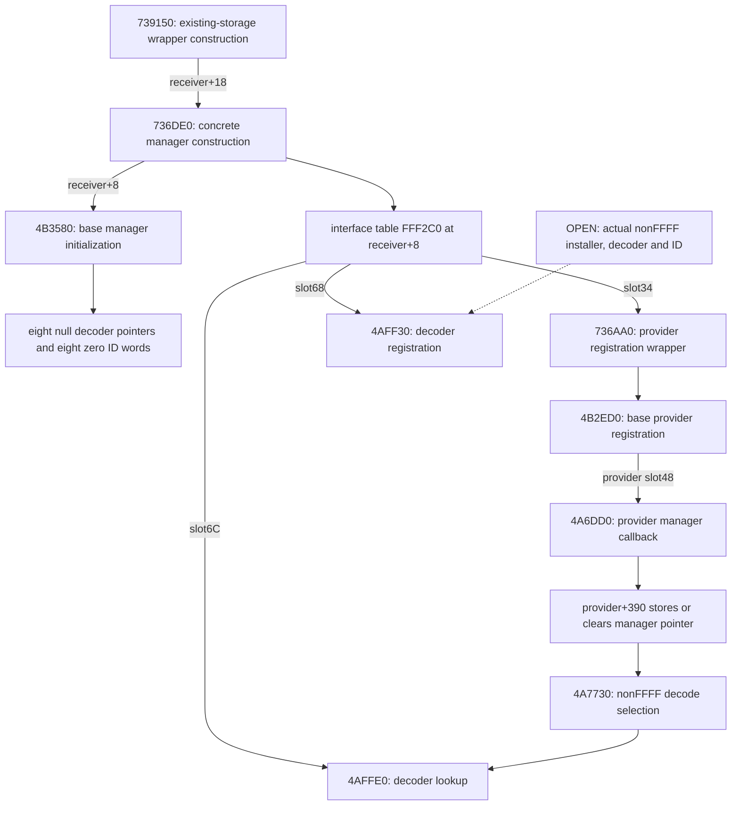

# Codec-registry producers and nonFFFF installation boundary

A manager pointer installed in a packed provider is not a configured decoder. This reference separates the Original construction/table/callback graph from a still-missing installer that supplies an actual nonFFFF ID and a concrete decoder object. It establishes no zlib mapping, runtime initialization, DLL alias, successful allocation or complete lifetime.

The [complete producer instruction ledger](../../evidence/native/resources/codec-registry-producers/instruction-evidence.json) contains13 ranges,5,023 bytes/1,472 starts across11 historical owner/context roots;738230 retains three ranges and six excluded gap bytes. The [stream/provider instruction ledger](../../evidence/native/resources/stream-failures/instruction-evidence.json) supplies the separately bounded registration/lookup/provider contexts. All bytes refer to the [central Original input](../../evidence/reference.json). These stored ranges/CFG contexts do not establish new Ghidra definitions, true logical extents or canonical ASM/C adoption.

The [source index](../../indexes/codec-registry-producers.tsv), [typed graph](../../evidence/native/resources/codec-registry-producers/producer-graph.json), [data prefixes](../../evidence/native/resources/codec-registry-producers/table-prefixes.json) and [finite search records](../../evidence/native/resources/codec-registry-producers/search-scope-and-candidates.json) retain the exact selected joins and their boundaries. Existing Original stream/DBPF and managed evidence are explicitly reused; [stream failure behavior](resource-stream-failure-boundaries.md) remains the companion contract.

Current canonical pairs are resolved in the linked address/source index. Immutable links labeled source retain the reviewed historical projections. Canonical availability does not close the body, annotation, ABI or lifetime limits below.

## Codec manager installation is distinct from a configured decoder ID

The original provider table `00FB3610+48` points to the qualified `[004A6DD0,004A6E76)` context. Its physical inputs are ECX provider plus three words, result AL, RET0C. First/third arguments are tested as low bytes:

* Add request: if an old manager differs from the requested manager, call provider+48 recursively with `(0, oldManager, thirdWord)` and ignore that result. Null requested manager fails. Third flag set directly stores requested manager into provider+390 and reports true. With that flag clear, call requested manager+34 with `(1, provider, 0)` instead; do not assert that the local body itself stores +390 on this branch.
* Remove request: a nonnull requested manager different from +390 fails. Third flag set clears +390 and reports true. Otherwise call current manager+34 `(0, provider, 0)`. That latter path contains no local null-current-manager guard.

The manager table `00FB3DB0+34` points to `004B2ED0`, a separately checked 443-byte/162-start existing extent. Its add path stores provider/priority records, performs selected secondary-interface refcount calls, leaves its monitor and calls provider+48 with `(1, manager, 1)`; its remove path calls `(0, manager, 1)` before removal/refcount operations. This supplies the concrete store/clear ingress for a PackedFile receiver using the selected table. It does not prove which manager/provider objects exist in a runtime process.

That same manager table+68 points to `004AFF30`, and +6C to `004AFFE0`, both qualified original contexts with no stored function-range row. In the add branch `004AFF30` stores a nonnull decoder pointer in the first free one of seven slots at manager+B8 and its low16 ID in the corresponding manager+D8 WORD. If none is free it returns false. It does not reject duplicate IDs on add. The removal branch compares decoder pointers and shifts the pointer slots through original memmove IAT `00F96688`; no corresponding ID-word shift is visible in this selected body. This is a bounded data-flow fact, **not a retail defect diagnosis**; actual registration/removal history and manager invariants remain unknown.

`004AFFE0` searches low16 requested ID through D8 while the corresponding B8 pointer is nonzero; first equal ID returns its pointer, otherwise zero at the first empty pointer. It does not retain the returned object or validate its lifetime in this context. Consequently lookup name, registry slot and low16 equality are not proof of a configured decoder implementation.

`004A7730`'s low16 FFFF path allocates its own 8-byte wrapper, whose constructor `004EC520` installs `00FBA058`; original label `ResourceLoad/PackedFile/CompressionRefpack` supports the existing RefPack identification, together with the already proven header/kernel bodies. Other IDs require nonnull provider+390 and manager+6C. Validation slot+C precedes a null-output query slot+8; query DWORD must equal row memory size. Stored-size zero or queried-size zero succeeds without expansion. Otherwise expansion's nonzero return is sufficient here, not equality to its output capacity. Only the locally constructed FFFF wrapper is destroyed with flag0 and explicitly passed to its allocator's +0C. The selected nonFFFF result is borrowed at this use site; full ownership/refcount policy remains unclosed.

`004A86A0` additionally rejects payload offset zero, allocates stored-size scratch via provider allocator+8, raw-reads through `004A8100`, dispatches the codec only after true AL, and calls allocator+0C on allocated scratch on success or failure. It reports false AL for null scratch or failed read/decode. Neither free success nor untouched output on failed expansion follows. The previous exact raw-read/short-read boundary remains in force.

## The producer graph now has concrete constructor nodes

Offsets in this graph belong to specific objects. **Provider+390** stores the manager pointer; manager+B8 holds decoder pointers and manager+D8 holds ID WORDs. They must not be conflated as a “manager+390” registry.

`004B3580` installs manager table `00FB3DB0`, chooses its allocator/context word or `0092F9C0` fallback, initializes the selected containers/monitors and finally writes eight zero pointer DWORDs at B8..D4 and eight zero WORDs at D8..E6. Its physical interface is ECX plus one word, receiver in EAX, RET4. It contains no decoder-install call. This supplies the original eighth zero sentinel expected by the separate add/lookup routines; it does not prove those entries remain zero after other participants act.

`00736DE0` calls that base initializer with ECX=`receiver+8` and argument0. It then installs `00FFF2C0` at that interface address, outer table `00FFF360` and additional embedded tables/state. The selected `00FFF2C0` slots68/6C are **the same actual original target DWORDs** `004AFF30`/`004AFFE0`; slot34 differs from the base and selects `00736AA0`. This is a concrete table/construction join, not a conclusion that a codec object has been installed. Calls to other constructors/hooks remain ordinary calls with their own unclosed side effects.

`00739150` initializes a wrapper in its supplied ECX storage, passes `receiver+18` to `00736DE0`, calls `00738230`. It then calls `00735EF0` with its first two incoming words, and calls `00735B50` only when its third incoming word is nonzero, subject to the preceding callees returning normally. It returns the receiver and RET0C. The original body **does not allocate the wrapper or publish it globally**. Runtime creation and global acquisition remain open. The two old full ASM/C pairs for 736DE0/739150 are reused and byte-checked, rather than requested again blindly.

`00738230`'s existing owned union is three ranges totaling1,128 bytes with six nonowned gap bytes in its envelope. Its own string/configuration loops and dispatch calls are preserved as a bounded dependency. This reference does not promote an arbitrary slot68 coincidence or an untyped call inside those operations into a codec installer. `004B3280` writes the base manager table on teardown and releases selected container/monitor state; that literal table store is explicitly **not** classified as another constructor.

## Provider callback installation has a concrete derived path

The qualified original context `[00736AA0,00736CDC)` is selected by the concrete manager interface table+34. It maintains additional collections/callbacks and at `00736C99` calls `004B2ED0` using the same manager-interface ECX and the three forwarded original words. That exact E8 and its start were verified. The selected context is not a new function definition; its extra loops/notifications, termination conditions and foreign lifetime are not collapsed into a pure registry store.

The previously proved base path then calls provider slot48 with `(1, manager, 1)` or `(0, manager, 1)`. A provider using table `00FB3610` reaches `004A6DD0`; the selected derived provider table `01049DA8` uses that **same slot48**. This body stores/clears provider+390 only in its third-flag branch, with the previously qualified recursive/manager callback branches retained.

`00994EB0` gives the latter provider table an original producer. Its three physical caller words are significant: it forwards **word2 and word3**, not word1, to base `004A9290`. Afterward it installs primary `01049DA8`, secondary `01049D94`, configures additional fields and uses original word1 as a NUL-byte string input for its additional descriptor or invokes the default helper. The base initializer's +390 zero and later callback store remain separate ordered operations; no codec ID is installed by this constructor body. The original caller scan found additional raw E8 candidates targeting this initializer, but only retained decoded/owned contexts establish actual instruction-level edges. Unreviewed candidates are labeled accordingly and are not expanded into another mass export.

Current Info-only reads explicitly report **Function not found** at `004A6DD0`, `004A7AB0`, `004AFF30` and `004AFFE0`. These current negative Info receipts are retained by reference; no C request, definition, boundary repair or retry is implied. The qualified original bytes/table joins remain useful evidence without pretending that a current Ghidra body exists.

## What can and cannot be concluded about nonFFFF configuration

The exact previously proved algorithm remains unchanged: manager virtual68 (`004AFF30`) can store a nonnull pointer and its low16 ID in the first free of seven decoder slots. It does not reject duplicate IDs. Manager virtual6C (`004AFFE0`) returns the first matching ID before the first empty pointer and does not retain it. Provider decoding `004A7730` uses provider+390 and that manager slot for nonFFFF, whereas low16 FFFF constructs the separate built-in RefPack wrapper. Shared slot numbers, a low16 value, a lookup name or a matching parameter count do not establish actual decoder identity or lifetime.

The following searches remain explicitly finite:

* The mapped executable-section raw E8/E9 scan finds no byte sequence targeting `004AFF30`, `004AFFE0` or `004A6DD0`; it finds one candidate targeting `004B2ED0`, which the concrete context above verifies at `00736C99`. This is not absence of indirect/DLL/dynamic calls.
* Exact original pointer-word searches find two data references each for register/lookup: the base and derived manager tables. Provider callback references join the base and selected derived provider tables. Pointer-word hits were not treated as registration callers.
* The manager neighborhood `[00733BE0,00738800)` contains two raw `FF [register+68]` patterns, but both begin **inside different instructions**. Whole stored-range decodes reject them: `00737B7F` is the last displacement byte of CALL `004DABA0`, followed by PUSHes; `0073850F` is the second byte of `ADD EDI,EDI`, again followed by PUSHes. Neither is an indirect call at that address. The companion restricted load68 pattern search in that neighborhood finds no rows; its omitted opcode/SIB/dataflow forms are stated.
* A broader `.text` raw `MOV register,[base+68]` followed within32 bytes by `CALL register` search yields172 candidates. Requiring raw PUSH1 within the stated nearby window reduces that to12. This is candidate reduction, **not an exhaustive indirect-call resolver**: it omits SIB, other opcode forms, longer dataflow, nonliteral flags and changed-register analysis. The [full finite candidate list](../../evidence/native/resources/codec-registry-producers/search-scope-and-candidates.json) is retained; 160 excluded-by-filter cases are not declared irrelevant.
* Two reduced candidates were fully original-decoded: `00518320` and `0051C8D0`. Their instruction-level slot68 calls and physical arguments are real, but their receiver-to-ResourceManager join is not established. Existing independently maintained UI proof identifies Button capture release and ComboBox modal close respectively; those prior interpretations are openly reused after original sealing. In particular the constant1 in the latter call is **not promoted to a configured codec ID1**. The other ten reduced candidates remain raw candidates, including one without a stored owner row.

The [selected table prefixes](../../evidence/native/resources/codec-registry-producers/table-prefixes.json) contain raw DWORD values. It does not assert every cell is a code pointer or that the capture size is a complete table size. In particular bytes at outer `00FFF360+70..90` contain `ResourceSystem/DatabaseKeyFilter`, not vtable targets. Only the stated interface slots are used for code joins.

## Original managed evidence remains a separate root

The [fifteen original ScriptCore selections and six exact registration/import-name joins](../../evidence/managed/resources/stream-failures/selected-methods.json) are reused explicitly, with full selected IL and qualified C# views; no target assembly was executed or newly extracted. A bounded name filter over the existing4,722 original native-declared/runtime root records for `codec`, `compress`, `resourcemanager` matches only the two CAS use-compression declarations `06000324/06000325`. That is an **index-name search**, not a new IL/ABI or codec-installation proof. Their names do not connect them to this registry. Methods without those substrings, callbacks, reflection and native module activation remain open. No reconstructed managed source tree substitutes for original evidence.

## Exact 5A42 search scope and the non-executable false positive

The exact byte searches425a0000 and68425a0000 were bounded to sections whose Characteristics include IMAGE_SCN_MEM_EXECUTE and each selected file interval `[PointerToRawData, PointerToRawData+min(VirtualSize,SizeOfRawData))`. The only selected section here is.text: file `[00001000,00B95351)`, mapped VA `[00401000,00F95351)`. Both counts are zero. A separate full raw.text search through file00B96000, including raw padding, is also zero for both. These are finite raw-byte searches, not a complete indirect/DLL/dynamic installer search.

The separately labeled whole-file comparison finds425a0000 once, at file00CF1A93/VA010F1A93 in non-executable.rdata, inside the ASCII `en-BZ` plus NUL/padding context;68425a0000 has no whole-file hit. The [search data](../../evidence/native/resources/codec-registry-producers/search-scope-and-candidates.json) retains the exact original context and section bounds. **This is not a codec identifier, instruction boundary, registration record or configured decoder.** Neither absence in.text nor presence in.rdata proves whether any nonFFFF codec is installed.

## Finite remaining installer question

The missing evidence is an actual installer call whose receiver joins FB3DB0 or FFF2C0, whose low16 ID is notFFFF and whose decoder pointer joins a concrete constructor/table. Its replacement/removal and reference ownership then require their own producers/consumers. The twelve raw PUSH1-filtered cases do not close this join; the other160 filter-excluded rows, other opcodes/SIB forms, longer or changed-register dataflow, stored function pointers, native modules/plugins and runtime-supplied callers remain unassessed. No unknown code is excluded as bloat.

Current Info still reports NoFunction for4A6DD0/4A7AB0/AFF30/AFFE0; their Original contexts and table joins remain useful without creating definitions or requesting invented C. Fresh current C is absent for4B3580/994EB0; valid historical pairs for736DE0/739150 are reused first. Their names, heads, parameter/local identities, incoming callers and persistence would need separate guarded annotation/adoption work. No next read, controller, definition or type/ABI repair is authorized by this reference.

The graph's static edges depend on the indicated receiver/table and preceding calls returning normally. They are not runtime activation, alias ownership, all-path cleanup, decoder success or liveness observations.
